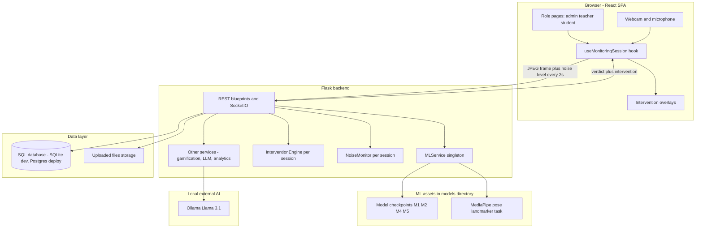
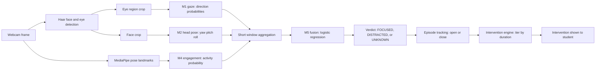

# SYSTEM.md — Luma Distraction-Detection LMS: Complete System Overview

> **Read this file first.** It is the single authoritative overview of this repository for AI agents and new developers. After reading it you should be able to answer: what this system is, who it serves, how a monitored learning session flows end to end, where every feature lives in code, how the ML pipeline works, what is genuinely implemented versus stubbed or planned, and how to run and test everything.
>
> **Status labelling convention (used throughout):**
> - **Implemented** — exists in code and is wired into the running system.
> - **Partial / stub** — files or scaffolding exist but the feature is incomplete, unused, mocked, or dead code.
> - **Planned** — described in `dev/PLAN_*.md` but not built yet. Do not treat planned items as existing behaviour.
>
> Code is the source of truth. `dev/METHODOLOGY.md` is a thesis chapter describing the *intended* design; where it and the code disagree, this file follows the code and says so.

---

## 1. Purpose and problem

**Luma** (product name in the UI: "Luma – Focus Learning") is a web-based learning management system (LMS) for students with ADHD that detects distraction from an ordinary laptop webcam and responds with gentle, escalating micro-interventions. It is a university research project (design-science artefact) as much as a product.

The research problem: there is no large public dataset of *labelled distraction in learners at a webcam*, and any single behavioural cue (gaze alone, head pose alone) is too brittle to act on. The system's answer is a hierarchical pipeline of specialised models — gaze, head pose, and body engagement — whose outputs are combined by a small late-fusion classifier over short time windows, plus a rule-based environmental (background-noise) trigger that needs no model at all.

Core principles that shape the whole codebase:

- **Webcam only, no special hardware.** A standard laptop camera and microphone are the only sensors.
- **Supportive, never punitive.** Detections trigger prompts, check-ins, checkpoint questions, pacing changes, breaks, and rewards — never grade penalties. Students are never shown the word "DISTRACTED" or a confidence score (see the Focus Buddy, §9.5).
- **Consent and privacy by design.** A monitored session cannot start without recorded guardian consent; the student gives separate assent during onboarding. Webcam frames are processed in memory and discarded; only verdicts, confidences, episode timings, and a microphone *loudness level* are stored or transmitted (see §11).
- **Interpretability over black boxes.** The fusion model is logistic regression, so each signal's contribution can be explained ("head turned away for 12 s"), and each sub-model can be replaced or retrained independently.
- **Graceful degradation.** If trained model weights are absent, the backend still runs and falls back to OpenCV heuristics rather than failing (see `ml_mode`, §5).

### Research objectives (from `dev/METHODOLOGY.md`)

1. Detect visual attention leaving the learning content in real time from a standard webcam.
2. Fuse several behavioural cues instead of relying on one signal.
3. Run inside a web LMS with consent and privacy designed in, not bolted on.
4. Convert detections into timely, low-disruption interventions suitable for learners with ADHD.

---

## 2. Users and roles

Access is role-based. Every protected API endpoint requires a JWT, and a server-side role-check decorator (`backend/app/utils/decorators.py`) enforces the role. The frontend mirrors this with route guards (`frontend/src/routes/ProtectedRoute.jsx`, `RoleRoute.jsx`).

| Role | Who they are | What they do in the system | Main API prefixes |
|---|---|---|---|
| **Student** | The core cohort: learners aged roughly 14–18 with ADHD (minors) | Browse and enrol in subjects, study video/document materials in monitored sessions, attempt quizzes, respond to interventions, view own focus analytics, earn XP/streaks/badges, set accessibility preferences | `/api/session`, `/api/courses`, `/api/student`, `/api/analytics` |
| **Teacher** | Course staff | Create subjects, modules, and materials; upload files; generate AI summaries and milestone questions (local LLM) and review/edit them; build quizzes; enable/disable intervention tiers per subject; view class analytics | `/api/courses`, `/api/analytics` |
| **Administrator** | Platform operator | Manage users (single create + CSV bulk import), activate/deactivate accounts, record guardian consent, configure system settings (e.g. intervention cooldowns), view platform analytics and dashboard stats | `/api/admin`, `/api/auth` |
| **Guardian** | Parent/guardian of a student (implicit, no login) | Their consent is recorded by an administrator and is a hard gate for monitored sessions; the student additionally confirms their own understanding ("assent") at onboarding | Consent endpoints under `/api/auth`, assent under `/api/student` |

Seed accounts for local development are created by `backend/seed.py` (admin, teacher, and student demo users; see that file for credentials).

---

## 3. System at a glance

The system is a three-tier client–server application with the ML inference running **in-process** inside the Flask backend (there is no separate ML microservice in the live system; `ML_SERVICE_URL` in config and the `apps/fastapi/` tree are vestigial — see §14).



**Tier summary:**

- **Presentation:** React 19 SPA (Vite, React Router 7, Tailwind CSS 4, Axios). Captures webcam frames (320×240) and microphone loudness in the browser, renders learning content, dashboards, and intervention overlays.
- **Application:** Flask 3 app-factory application with blueprints for auth, courses, quizzes, sessions, analytics, student profile, and admin; a service layer (ML inference singleton, intervention engine, noise monitor, gamification, analytics/focus metrics, LLM client, CSV importer, file storage); and a Flask-SocketIO/eventlet telemetry channel that mirrors the REST heartbeat (the live frontend path is REST).
- **Data:** SQLAlchemy ORM over SQLite (development/tests) or PostgreSQL (deployment, via `DATABASE_URL`); uploaded learning materials (PDFs, videos, images) in server file storage under `backend/uploads/`.
- **External AI:** a locally hosted Ollama (Llama 3.1) instance generates material summaries and milestone questions for teachers. All AI runs on institutional/local infrastructure; nothing is sent to a cloud LLM.

---

## 4. The live monitoring loop (the heart of the system)

This is the loop everything else exists to support. It is implemented primarily in `frontend/src/hooks/useMonitoringSession.js` (client) and `backend/app/routes/session.py` + `backend/app/services/ml_service.py` + `backend/app/services/intervention_engine.py` (server).

1. **Consent check.** When a student starts a monitored session (`POST /api/session/start`), the backend verifies enrolment in the module's subject and, for monitored sessions, that a `GuardianConsent` record with `consent_given = true` exists. Without consent the request is rejected (403) before any camera data is involved.
2. **Session start.** In the browser's start flow, camera (and, if permitted, microphone) capture opens first — nothing leaves the device at this point — and the session is then created via the API; if camera access fails, no session is started. The backend ends any other active sessions for that student (closing open distraction episodes), creates a `LearningSession`, and registers a fresh per-session `InterventionEngine` and `NoiseMonitor` in in-memory registries keyed by session id (`SESSION_ENGINES`, `SESSION_NOISE_MONITORS` in `backend/app/routes/session.py`). Camera access is mandatory for a monitored session; microphone access is not (see step 4).
3. **Heartbeat (every ~2 seconds).** The student's browser draws the current webcam frame to a 224×224 canvas and sends it as a base64 JPEG to `POST /api/session/<id>/heartbeat`, together with `is_quiz_context` and the environmental fields `noise_dbfs` and `lesson_audio_active` (§6). Only one heartbeat request is in flight at a time.
4. **On-device loudness measurement.** Alongside the camera, the browser opens the microphone with echo cancellation, noise suppression, and automatic gain control disabled (those would remove the noise being measured), computes the RMS of the audio buffer via an `AnalyserNode`, converts it to dBFS, and sends only that number. No audio is recorded, uploaded, or stored. If the microphone is denied or unavailable, capture falls back to camera-only and `noise_dbfs` is simply absent/null.
5. **Server-side ML inference.** `MLService.predict_frame_image` (singleton, `backend/app/services/ml_service.py`) processes the frame: face/eye regions are located (OpenCV Haar cascades), Model 1 estimates gaze direction probabilities, Model 2 regresses head-pose angles, **per-session** MediaPipe Pose Landmarker instances extract upper-body landmarks (Phase 2A: no shared VIDEO tracker across sessions), Model 4 turns windowed pose features into an engagement probability, and Model 5 (fusion) combines the windowed features into one verdict. Per-session frame buffers (deque, max 32 frames; scoring window `ML_WINDOW_FRAMES`, default 3) smooth single-frame noise. A decoded image with **no detected face** yields **`UNKNOWN`** (`reason: no_face`, `confidence: null`, `face_detected: false`) — not focused or distracted time. Missing/undecodable images and inference exceptions also yield **`UNKNOWN`** with no fabricated confidence or `face_detected: true`.
6. **Verdict.** The response carries `verdict` (`FOCUSED`, `DISTRACTED`, or `UNKNOWN`), `confidence` (null for UNKNOWN), `ml_mode`, optional `reason` / `gaze_label` / `engagement_score` / `face_detected`, and each heartbeat is also stored as a `MonitoringObservation` for coverage accounting (`observed_at` = server receive/process time, not camera capture time). `ml_mode` reports which checkpoint set is loaded:
   - `full` — all four checkpoints (M1, M2, M4, M5) loaded;
   - `partial` — some checkpoints loaded, heuristic gates fill the gaps;
   - `fallback` — no checkpoints; pure OpenCV Haar face/eye heuristics (e.g. gaze-away ratio or head-angle thresholds). The backend always starts, even with no weights present.
   Valid heuristic classifications remain `FOCUSED`/`DISTRACTED` with a separate `inference_path` of `heuristic`; unusable input uses `inference_path: unusable`.
7. **Episode tracking.** The backend does not act on single frames. A `DISTRACTED` verdict opens a `DistractionEvent` (an *episode*) or extends the open one when the gap from the prior DISTRACTED sample is ≤ `T_support` (3 s); a gap `> T_support` closes the prior episode at `prior + T_support` and opens a new one so unknown remainders do not inflate escalation duration. A `FOCUSED` verdict closes with re-engagement. An `UNKNOWN` observation **closes** any open episode at the UNKNOWN timestamp without counting as re-engagement. Normative rules: `dev/OBSERVATION_COVERAGE_SPEC.md`.
8. **Intervention decision.** If the session is monitored, `InterventionEngine.decide_intervention` receives an explicit `observation_state`. `DISTRACTED` maps open-episode duration to a tier (§7). `FOCUSED` calls `reset_on_focus`. `UNKNOWN` calls `hold_on_unknown` — no escalation and **no** focus-reset (pending interventions and cooldowns stay unchanged; no fabricated student outcome). Do not rely on `is_distracted=False` alone for UNKNOWN. If (and only if) no visual intervention fired, the `NoiseMonitor` may fire its isolated tier-1 cue (§6).
9. **Student response and outcome.** The frontend renders the intervention (overlay components, §9.3). The student's response — `reengaged`, `ignored`, or `ended`, sometimes with a milestone answer — is posted to `POST /api/session/<id>/intervention-response`, stored on the log (including time-to-re-engage), graded server-side for milestone questions, and fed back into the engine (`record_outcome`): re-engaging resets escalation; ignoring escalates the next intervention by one tier.
10. **Session stop.** `POST /api/session/<id>/stop` ends the session, closes any open episode, destroys the engine/noise-monitor and **per-session MediaPipe landmarker**, computes **observed_v1** coverage (`dev/OBSERVATION_COVERAGE_SPEC.md`, `focus_metrics.py` / `observation_coverage.py`): focused / distracted / unknown seconds and monitoring coverage %; `focus_percentage` is over **valid observed time only** (null when none). XP is claimed and awarded in **one DB transaction** using `observed_focused_seconds` (unknown time earns no focus XP). Response includes coverage fields and `focus_metric_version`. Legacy sessions without stored observations are not backfilled.

A parallel Socket.IO channel (`backend/app/socket_events/telemetry.py`, events `join_session`, `telemetry_window`, `intervention_outcome`) implements the same pipeline for lower-latency telemetry and shares the same engines and persistence helpers; the current frontend uses the REST heartbeat, and the socket client (`frontend/src/services/socketService.js`) is dormant. **Planned:** switching the live path to this channel at higher frame rate (see §15).



---

## 5. ML models (`models/`)

The research code lives under `models/src/`. All live inference is done by one in-process singleton, `MLService` (`backend/app/services/ml_service.py`), which loads the checkpoints below directly from the `models/` directory. The browser never runs these models; it only sends frames.

**Formulation.** Binary classification over short windows: each window is labelled focused or distracted. Sub-models produce per-frame or per-window signals; the fusion model consumes a windowed feature vector (gaze class probabilities and gaze-away ratio, head-pose angle means — and standard deviations where available — and the engagement probability; 9–12 features depending on which producers are available) and outputs the probability of distraction, compared against a stored threshold. Windows smooth over blinks and momentary glances.

### Model 1 — Gaze direction (`models/src/model1_gaze/`) — Implemented

- **Task:** 4-class gaze direction from eye patches: `center`, `left`, `right`, `down` (an `up` class exists in data preparation but is not used downstream).
- **Architecture:** MobileNetV2 (ImageNet-pretrained), classifier head replaced; grayscale eye patches repeated to 3 channels.
- **Data:** MPIIGaze normalised eye patches; the 3-D gaze vector is converted to yaw/pitch and thresholded (roughly |angle| < 10° ⇒ center, otherwise dominant axis). **Subject-wise split** (train p00–p10, val p11–p12, test p13–p14) so reported scores are on unseen people.
- **Training:** class-weighted cross-entropy, AdamW, cosine schedule, best checkpoint selected by validation macro-F1; checkpoint stores `img_size` (the deployed checkpoint is a 96 px retrain — consumers must read `img_size` from the checkpoint, not assume 224).
- **Known status:** an early checkpoint was saved at epoch 2 of 15 with test macro-F1 ≈ 0.54; a retrain (2026-10-21) reached ≈ 60.2% accuracy / macro-F1 0.559 on the MPIIGaze test split. `models/gaze_out.txt` is header-only, so there is no complete recorded gaze evaluation in the repo — re-run `models/run_tests.py` for current numbers.

### Model 2 — Head pose (`models/src/model2_pose/`) — Implemented

- **Task:** regression of head `yaw`, `pitch`, `roll` in degrees from a face crop.
- **Architecture:** ResNet-18 with a 3-output linear head (defined inside `train.py`; `model.py`/`dataset.py` in this folder are stubs and the real logic lives in `train.py`, `prepare.py`, `infer.py`).
- **Data:** BIWI Kinect head-pose dataset; rotation matrices converted to ZYX Euler angles. Subject-wise split (train 01–14, val 15–17, test 18–20).
- **Training:** Smooth L1 loss, AdamW; checkpoints `outputs/checkpoints/model2_pose/{best,last}.pt`. Evaluated by per-angle MAE (degrees).
- **Known gap:** inference window output emits angle *means* only, not the standard deviations the fusion feature set can optionally use; fusion tolerates their absence. There is also a train/serve mismatch noted in `dev/PLAN_1...`: training used full BIWI frames while live inference uses face crops.

### Model 3 — Audio (`models/src/model3_audio/`) — Stub (intentionally not a model)

Every file in this folder is a one-line placeholder. **There is no audio ML model, and none is needed:** background noise is handled by direct loudness measurement (browser RMS → dBFS) plus the rule-based `NoiseMonitor` (§6). Do not cite Model 3 as an implemented component; in thesis terms it is superseded by the loudness trigger.

### Model 4 — Engagement / activity (`models/src/model4_engagement/`) — Implemented, with a labelling caveat

- **Task:** binary `active_work` vs `inactive` from upper-body pose behaviour over ~2 s windows.
- **Pipeline (non-standard file names):** `extractpose.py` runs MediaPipe Pose Landmarker (bundled `pose_landmarker_lite.task`) and exports per-frame landmarks (nose, shoulders, elbows, wrists); `buildfeatures.py` aggregates 12 window features (pose presence ratio, wrist speed mean/std, wrist-to-nose and wrist-to-shoulder distances, nose jitter, hands-below-shoulder ratios); `labelweak.py` assigns **rule-based weak labels** (e.g. pose present > 70% of frames AND a wrist below the shoulders > 60% AND mean wrist speed above a threshold AND low nose jitter ⇒ active); `train.py` fits a `StandardScaler + LogisticRegression` pipeline saved as `model.pkl`.
- **Recorded result:** ≈ 97.4% accuracy / macro-F1 0.973 / ROC-AUC 0.998 on 76 held-out windows (`models/eng_out.txt`).
- **Caveat (important for any evaluation claim):** because the labels are generated by deterministic rules over the *same* 12 features the classifier consumes, this score largely measures how well logistic regression can recover the labelling rule — not accuracy against human-labelled engagement. Treat Model 4 as a smooth, learned version of a hand-crafted activity heuristic.

### Model 5 — Fusion (`models/src/model5_fusion/`) — Implemented, currently the weak link

- **Task:** final `FOCUSED` / `DISTRACTED` verdict from windowed M1+M2+M4 outputs. This is the model whose probability the live system thresholds.
- **Implementation:** `prep.py` (current data preparation; an older `prepare.py` with an unusable single-class split also exists — do not use it) merges per-video window CSVs from the three producers on `(video_id, window_start_sec)`, builds the feature vector, and assigns **hybrid weak labels**: a window from a "distracted" recording counts only if it actually shows aversion (high gaze-away ratio or large head angles), focused/natural windows must be geometrically plausible, and contradictory windows are dropped as ambiguous. `train.py` fits `StandardScaler + LogisticRegression` (max_iter 2000, C = 1.0) with optional validation threshold tuning; the package `{model, features, threshold, ...}` is saved as `model.pkl`. There is no `infer.py`/`eval.py` in this folder — fusion inference exists only inside `models/run_tests.py`, the video test harnesses, and the backend `MLService`.
- **Training data (as shipped):** effectively **3 self-recorded videos from one setup/person** (`distracted`, `forced`/`focused`, `natural`), ~800 windows.
- **Honest performance (`models/fus_out.txt`):** leave-video-out evaluation gives **ROC-AUC ≈ 0.77, F1 ≈ 0.54** at threshold 0.50 on 82 test windows. The validation-tuned threshold (0.745) collapses to **zero distracted recall (F1 = 0.000)** — it predicts everything as focused. Earlier headline numbers (≈100% test accuracy) came from a random split over overlapping windows of the same videos (train/test leakage) and must not be quoted. Retraining on multi-participant data is the subject of `dev/PLAN_fusion_video_training.md` (§15).
- A legacy duplicate package `models/src/fusion/` contains only stubs; `model5_fusion/` is the real one.

### Model 6 — Natural distraction (`models/src/model6_natural/`) — Planned / benchmark only

Contains only `benchmark_training_time.py`, which times logistic regression vs gradient boosting under leave-one-subject-out (LOSO) cross-validation on a **synthetic** feature table (its own documentation stresses the synthetic scores are not results). It defines the intended next-generation feature set and evaluation protocol for natural-distraction detection (§15) but is **not trained on real data and is not wired into the backend**.

### Checkpoints and degradation

Checkpoints are **not committed to the repository** (local/gitignored). Expected locations and overrides are documented in `models/CHECKPOINTS.md`:

| Model | Default path (relative to `models/`) | Env override |
|---|---|---|
| M1 gaze | `outputs/checkpoints/model1_gaze/best.pt` | `GAZE_CKPT` |
| M2 pose | `outputs/checkpoints/model2_pose/best.pt` | `POSE_CKPT` |
| M4 engagement | `outputs/checkpoints/model4_engagement/model.pkl` | `ENG_CKPT` |
| M5 fusion | `outputs/checkpoints/model5_fusion/model.pkl` | `FUSION_CKPT` |
| MediaPipe | `src/model4_engagement/pose_landmarker_lite.task` (bundled, present) | fixed |

With all four present the backend reports `ml_mode = full`; missing weights degrade to `partial`/`fallback` (Haar heuristics) with warnings in the server log — the app still starts and serves sessions. Shared utilities under `models/src/common/` are one-line stubs: there is no shared ML library, and preprocessing/windowing logic is duplicated (with some drift) across `models/src/*`, the root-level video harnesses (`models/webcam_test.py`, `models/test_*_video.py`, `models/run_tests.py`), and the backend. `models/webcam_test.py` is the standalone desktop prototype from which `MLService` was ported.

---

## 6. Background-noise trigger (environmental, non-ML)

Implemented across `frontend/src/hooks/useMonitoringSession.js`, `backend/app/services/noise_monitor.py`, `backend/app/schemas/session_schema.py`, and `backend/app/routes/session.py`. Rationale: "is the room too loud?" is a measurement, not a classification problem, so no model is trained and no Python audio library is involved server-side (a server-side library could not hear the student's microphone anyway).

- **Measurement (browser):** RMS of the raw microphone buffer → dBFS (`20·log10(RMS)`, clamped to −100…0), computed on-device once per heartbeat. Only the number leaves the device.
- **Baseline:** the first 5 usable samples of a session form a **median baseline** (≈ first 10 s), absorbing differences in microphone gain between laptops. A fixed absolute threshold would false-alarm on sensitive mics and never fire on quiet ones.
- **Trigger rule:** a sample is loud at **≥ +12 dB above baseline**; **4 consecutive loud heartbeats (~8 s)** are required. A cough, door, or dropped book cannot fire it.
- **Already-loud room:** if the baseline itself is ≥ −20 dBFS, the notice fires immediately after calibration instead of waiting for a further rise.
- **One-time per session:** a detection stays pending (`NoiseMonitor.update()` keeps returning `True`) until the heartbeat route confirms the notice was persisted and calls `mark_notice_shown()` — so a detection blocked by a pending visual intervention is not lost. After that latch, the monitor never fires again in that session, however loud it gets.
- **The notice (modal, lesson-pausing):** the trigger is a distinct intervention type, `environment_noise_notice` (tier 1 for cooldown/toggle purposes), rendered by `frontend/src/components/intervention/NoiseNotice.jsx` as a modal that pauses the lesson (in `VideoLearningPlayer` the video is paused and resumes on response; on reading/quiz surfaces the modal blocks interaction). The student must pick one of three options to continue — **I'll use headphones**, **I'll move somewhere quieter**, or **Continue anyway** — there is no skip or dismiss. The choice is sent back as `noise_action` (`headphones | move_environment | continue_anyway`) with `user_response = reengaged` and stored on the `InterventionLog.noise_action` column.
- **Lesson-audio guard:** while a lesson video is playing unmuted (`lesson_audio_active = isPlaying && !isMuted` from `VideoLearningPlayer.jsx`), the speakers feed the lesson back into the microphone, so those samples are ignored entirely — they neither calibrate the baseline nor advance the loud streak. Headphones or a muted lesson are when this signal is meaningful. Missing-microphone (`null`) samples are likewise ignored.
- **Isolation from visual distraction (deliberate design):** noise never changes the ML verdict, never opens a distraction episode, and only ever fires the tier-1 `environment_noise_notice` — with `payload.trigger_source = "background_noise"` so it can be separated in analytics. `InterventionEngine.consider_noise()` shares the pending-intervention lock and cooldown with visual cues (no stacking) but does **not** touch the visual escalation state (`last_tier`, `last_outcome`, `t4_used`): responding to the noise notice cannot escalate the next camera-based intervention, and a permanently noisy room cannot climb to "suggest a break". If tier 1 is disabled for the subject, noise fires nothing.
- **Limitation:** loudness cannot identify the source (speech vs TV vs fan); the notice wording therefore comments on the room, never accuses the student of talking, and shows no decibel values.

Heartbeat fields: `noise_dbfs` (optional float, −100…0) and `lesson_audio_active` (bool) in the request; `noise_dbfs`, `noise_baseline_dbfs`, and `noise_triggered` are echoed in the response. Intervention responses for the notice carry `noise_action` (validated in `session_schema.py`, persisted and returned by the response handler).

---

## 7. Intervention engine

Implemented in `backend/app/services/intervention_engine.py` (per-session in-memory `InterventionEngine`), persisted via `InterventionLog` rows, and configured per subject by teachers (`InterventionConfig`) and globally by admins (`SystemSetting` cooldowns).

Severity is derived from **how long the current distraction episode has been open**, not from per-frame labels:

| Open-episode duration | Level/Tier | Intervention type | Behaviour |
|---|---|---|---|
| < 5 s | 0 | — | No action; brief glances are tolerated and never punished |
| 5–10 s | 1 | `ambient_cue` | Gentle non-modal refocus cue (glowing border/toast) |
| 10–20 s | 2 | `pacing_pause` | Content pauses; student taps to continue (includes an emoji self-report) |
| 20–40 s | 3 | `milestone_quiz` (or `hint_injection` in a quiz) | One checkpoint question on the current material, answer to continue; in a quiz the student instead gets a scaffolded hint so the assessment is not interrupted |
| ≥ 40 s | 4 | `content_pacing_reduction`, then `suggest_break` | First severe episode slows playback (0.75× pacing factor); a further severe episode suggests a short (optionally gamified breathing) break |

Control rules:

- **Cooldown:** at least 30 s between interventions by default (`intervention_min_cooldown_seconds` system setting, admin-configurable).
- **No stacking:** while an intervention is awaiting the student's response (`_pending_intervention`), no new intervention — visual or noise — can fire.
- **Escalation on ignore:** if the previous intervention's outcome was `ignored`, the next visual intervention is raised by one tier.
- **Reset on focus:** a `FOCUSED` verdict (or a `reengaged` outcome) fully de-escalates the engine.
- **Per-subject tier toggles:** teachers can disable tiers per subject; the engine falls back to the nearest enabled *lower* tier. If tier 1 is disabled, the noise trigger (tier-1 only) fires nothing.
- **Manual/demo triggering:** `POST /api/session/<id>/trigger-intervention` forces a tier (used by the hidden examiner Demo Panel, §9.5); returns 409 while another intervention is pending or the tier is disabled.
- **Milestone grading:** milestone/hint payloads are enriched from the teacher-approved question bank (`ModuleMilestoneItem`) and the correct option is kept server-side only; the student's selected option is graded on response. LLM-generated fallback questions exist when no bank item is available.
- **Logging:** every intervention records tier, type, linked episode (null for noise), student response, and time-to-re-engage (`reengaged_in_seconds`) — the raw material for intervention analytics. Noise notices additionally store the student's chosen fix in `InterventionLog.noise_action`.
- **Noise exception:** the background-noise trigger (§6) does not use this duration ladder at all. It fires its own once-per-session modal type, `environment_noise_notice`, at tier 1 (for cooldown and per-subject toggle purposes), pauses the lesson, and never escalates.

Frontend renderers for each type live in `frontend/src/components/intervention/` (`AmbientCue`, `PacingPrompt`, `MilestoneQuiz`, `HintInjection`, `GamifiedBreak`, `StructuralNotice`, `NoiseNotice`, dispatched by `InterventionOverlay`).

---

## 8. Backend reference (`backend/`)

**Stack:** Flask 3 (app factory in `backend/app/__init__.py`, entry `backend/wsgi.py`), Flask-SQLAlchemy + Flask-Migrate, Flask-JWT-Extended, Flask-SocketIO with eventlet, Pydantic 2 schemas, bcrypt, python-dotenv. ML runtime in-process: PyTorch/torchvision, scikit-learn + joblib, OpenCV (headless), MediaPipe, NumPy, Pillow (`backend/requirements.txt`). Default port 5000; production note: a single eventlet worker (`gunicorn --worker-class eventlet -w 1 wsgi:app`) because Socket.IO connections and all per-session runtime state are in-memory in one process.

**App factory behaviour worth knowing:** loads `.env`, selects config (`backend/app/config.py`: development/testing/production via `FLASK_ENV`; testing uses in-memory SQLite), registers CORS, a global JSON error handler, Socket.IO telemetry listeners, `db.create_all()`, several hand-rolled `ALTER TABLE` schema patches for SQLite/Postgres compatibility (the project does not rely on Alembic migrations at boot), seeds default system settings (`intervention_min_cooldown_seconds=30`, `intervention_max_cooldown_seconds=120`, `data_retention_days=90`), serves `GET /uploads/<filename>`, and registers the blueprints below. Shared extension singletons live in `backend/app/extensions.py`.

### 8.1 Route blueprints

All under `/api/*`; JWT required except login. Roles are enforced by `role_required` (`backend/app/utils/decorators.py`, reads the JWT `role` claim), plus finer ownership/enrolment checks inside handlers.

| Blueprint (file) | Prefix | Main endpoints and purpose |
|---|---|---|
| `auth_bp` (`app/routes/auth.py`) | `/api/auth` | `POST /login` (bcrypt check, JWT with role claim), `GET /me`, `POST /register` (admin-only user creation), `GET/PATCH /students/<id>/consent` (guardian consent read/write; PATCH admin-only) |
| `admin_bp` (`app/routes/admin.py`) | `/api/admin` | `GET /users` (search/role filter/pagination), `PATCH /users/<id>/status` (activate/deactivate; self-deactivation blocked), `POST /users/bulk-import` (CSV), `GET /dashboard/stats`, `GET/PATCH /settings` (validated against known settings, min ≤ max cooldown cross-check) |
| `courses_bp` (`app/routes/courses.py`) | `/api/courses` | Grade levels; subjects CRUD + archive; modules; materials CRUD + file upload (`POST /upload`); `POST /materials/generate-pack` (LLM, teacher); student enrol/drop and `my-enrollments`; per-subject intervention-config GET/PATCH (teacher). List results are role-scoped: teacher → own subjects, student → own grade level, admin → all |
| `quizzes_bp` (`app/routes/quizzes.py`) | `/api/courses` (shared) | Quiz CRUD under modules, `GET /quizzes/<id>` (correct answers only revealed to admin/owning teacher), `POST /quizzes/<id>/attempts` (single-attempt policy), `POST /attempts/<id>/submit` (grading + quiz XP), attempt listing |
| `session_bp` (`app/routes/session.py`) | `/api/session` | The monitoring core: `POST /start`, `POST /<id>/heartbeat`, `POST /<id>/trigger-intervention`, `POST /<id>/intervention-response`, `POST /<id>/stop` (§4). Student-only and ownership-checked on every call |
| `analytics_bp` (`app/routes/analytics.py`) | `/api/analytics` | `GET /teacher`, `GET /student`, `GET /admin` — computed inline from sessions/episodes/quiz attempts using `focus_metrics` (the separate `AnalyticsService` is a mock, see §14) |
| `student_profile_bp` (`app/routes/student_profile.py`) | `/api/student` | `GET/PATCH /profile` (grade, guardian info, assent, onboarding flag, UI preferences merge, daily goal), `GET /progress` (XP/level/streak/badges), `GET /badges` |

`backend/app/routes/sessions.py` (`sessions_bp`) is **legacy dead code**: it is never registered and imports schema names that no longer exist. Do not build on it; `session.py` is the live route module.

### 8.2 Services (`backend/app/services/`)

| Service | Responsibility |
|---|---|
| `ml_service.py` | `MLService` singleton (§5): loads M1/M2/M4/M5 checkpoints; **per-session** MediaPipe VIDEO landmarkers + timestamps; per-session frame buffers; `predict_frame_image` → FOCUSED/DISTRACTED/UNKNOWN; no-face / decode failure / inference exception ⇒ UNKNOWN; valid heuristic/fusion remain FOCUSED/DISTRACTED; `clear_session()` on stop and on auto-close when a new session starts |
| `intervention_engine.py` | Per-session escalation state machine (§7): duration→tier bands, cooldown, pending lock, ignored-escalation, per-subject enabled-tier fallback, `decide_intervention(observation_state=…)`, `hold_on_unknown`, `consider_noise` (isolated tier-1), `force_intervention` (manual), `record_outcome`, `reset_on_focus` |
| `noise_monitor.py` | Pure loudness logic (§6): median baseline (5 samples), +12 dB, 4-beat sustain, already-loud (≥ −20 dBFS), once-per-session latch via `mark_notice_shown()`; ignores lesson-audio and missing samples. No audio I/O |
| `observation_coverage.py` | Normative interval accounting for `observed_v1` (see `dev/OBSERVATION_COVERAGE_SPEC.md`): T_support=3 s coverage + episode continuity; T_gap_max=5 s interrupted-monitoring detector only; null focus when no valid observations |
| `focus_metrics.py` | `compute_session_coverage` / `compute_session_focus_percentage` (observed_v1; null when unavailable), `average_focus_percentage` (excludes legacy rows without coverage), optional `legacy_wallclock_focus_percentage` for comparison only |
| `gamification_service.py` | XP awards (session XP from **observed focused seconds**, quiz, module completion), level curve, streak tracking, badge definitions/unlocks, progress payloads (§10) |
| `llm_service.py` | Ollama client (stdlib `urllib`, JSON mode, timeout): `generate_material_pack(...)` → summary + milestone MCQs with validation/clamping and a fallback question; raises `LLMUnavailableError` when Ollama is down (§10) |
| `csv_importer.py` | Pure CSV parse/validate for bulk user import (schema validation, in-file duplicate detection, optional grade whitelist); no DB access |
| `user_service.py` | Shared user creation (bcrypt hash, role profile rows, guardian-consent row defaulting to not-given) used by registration and bulk import |
| `storage_service.py` | Upload validation (pdf/doc/docx/ppt/pptx/txt/mp4/webm/png/jpg/jpeg) and storage under the upload folder with randomised filenames |
| `analytics_service.py` | **Stub/mock** — returns hardcoded DSM-style summary values; live analytics are computed in the routes. `DSMSummary` table exists but is not populated by a real aggregator |

### 8.3 Data model (`backend/app/db_models/`, 26 tables)

- **Identity (`user.py`):** `User` (email, bcrypt password, role enum admin/teacher/student, active flag), `Student` (unique user link, `pseudonym_id` UUID for privacy-safe analytics, grade level, `ui_preferences` JSON, `student_assent`, `onboarding_completed`), `Teacher`, `GuardianConsent` (one per student, `consent_given` gate).
- **Courses (`course.py`):** `GradeLevel`, `Subject`, `TeacherSubject` (teacher↔subject), `Module` (ordered), `ModuleContent` (video/document/quiz/other, `file_url`, LLM `summary`), `ModuleMilestoneItem` (teacher-approved checkpoint questions with options/correct index/hint), `Enrollment` (student↔subject).
- **Quizzes (`quiz.py`):** `Quiz` → `QuizQuestion` (multiple-choice/short-answer) → `QuizQuestionOption`; `QuizAttempt` (optionally linked to a monitoring session) → `QuizAnswer`.
- **Sessions & interventions (`session.py`, `analytics.py`):** `LearningSession` (physical columns renamed — `module_id` → `module_content_id`, times → `started_at`/`ended_at`; Phase 2A: `xp_awarded`, `focus_metric_version`, observed_* seconds, `monitoring_coverage_pct`, nullable `focus_percentage`); `MonitoringObservation` (per-heartbeat FOCUSED/DISTRACTED/UNKNOWN samples for coverage); `DistractionEvent` (episode: lowercase `focused`/`distracted` enum in DB vs uppercase API verdicts — UNKNOWN is never stored here); `InterventionLog`; `MilestoneQuestion`; `InterventionConfig`; `DSMSummary` (unpopulated).
- **Gamification (`gamification.py`):** `StudentProgress` (XP, level, streaks, daily goal, focus minutes), `Badge`, `StudentBadge`.
- **Settings (`system_setting.py`):** `SystemSetting` key→string-value rows (cooldowns, retention).

### 8.4 Realtime, state, and schemas

- **Socket.IO** (`app/socket_events/telemetry.py`): JWT-authenticated connect; `join_session`, `telemetry_window`, and `intervention_outcome` events run the same ML → episode → engine → persistence pipeline as the REST heartbeat and emit `telemetry_verdict` / `intervention_triggered` to the session room. It shares `SESSION_ENGINES` and helpers with `routes/session.py`.
- **In-memory state caveat:** intervention engines, noise monitors, ML frame buffers, and **per-session MediaPipe PoseLandmarker instances** live in process memory keyed by session id. Each concurrent monitored session holds its own landmarker (task file shared on disk). They are destroyed on `clear_session` / stop and are lost on restart — reason for the single-worker deployment constraint.
- **Schemas** (`app/schemas/`, Pydantic v2): `auth_schema`, `course_schema`, `quiz_schema`, `session_schema` (heartbeat includes bounded `engagement_score`, `noise_dbfs` −100…0, `lesson_audio_active`), `settings_schema` (known-settings bounds). `user_schema.py` is legacy Marshmallow and unused by routes.

---

## 9. Frontend reference (`frontend/`)

**Stack:** React 19 + React DOM (plain JSX, no TypeScript), Vite 8, React Router 7, Axios (single instance, `src/services/api.js`), Tailwind CSS 4 (CSS-first config in `src/index.css`, no `tailwind.config.js`), lucide-react icons, Recharts (student analytics), canvas-confetti, socket.io-client (installed but dormant, §8.4). Base API URL from `VITE_API_BASE_URL` (fallback `http://localhost:5000/api`). Scripts: `npm run dev`, `npm run build`, `npm run lint`, `npm run preview`.

### 9.1 Entry, routing, guards

`index.html` → `src/main.jsx` (StrictMode, imports `index.css`) → `src/App.jsx`: providers `AuthProvider > PreferencesProvider > BrowserRouter`, a catch-all redirect to the role dashboard or `/login`, and this route table (all role routes wrapped in `ProtectedRoute` + `RoleRoute`):

| Area | Layout | Routes |
|---|---|---|
| Public | — | `/login` |
| Admin | `components/admin/AdminLayout.jsx` | `/admin/dashboard`, `/admin/users`, `/admin/analytics`, `/admin/logs`, `/admin/settings` |
| Teacher | `components/teacher/TeacherLayout.jsx` | `/teacher/dashboard`, `/teacher/courses`, `/teacher/courses/:id`, `/teacher/analytics`, `/teacher/students`, `/teacher/settings` |
| Student | `components/student/StudentLayout.jsx` | `/student/dashboard`, `/student/courses`, `/student/subjects/:id`, `/student/quizzes/:quizId`, `/student/analytics`, `/student/settings` |

All three `/settings` routes render the shared dispatcher `src/pages/admin/SettingsPage.jsx`, which switches on role. `StudentLayout` additionally loads profile/progress, shows `FirstTimeOnboardingModal` until onboarding completes, passes `{profile, progress, refreshProfile, refreshProgress, focusMode, setFocusMode}` via Outlet context, and in focus mode hides the top bar.

### 9.2 Pages

- **Admin:** `AdminDashboard` (platform stats, quick actions), `UserManagement` (searchable/paginated users, activate/deactivate, consent indicator, create + CSV-import modals), `AnalyticsPage` (platform metrics), `SystemSettings` (cooldowns, retention), `SystemLogs` (**placeholder page**, no data).
- **Teacher:** `TeacherDashboard` (courses, trends panels, quick actions), `CourseList` (create/archive subjects), `CourseEditor` (the authoring hub: modules, materials upload/edit, quizzes, embedded per-subject `InterventionSettings`), `TeacherAnalytics` (class focus/quiz analytics with per-subject table), `TeacherSettings`, `TeacherStudents` (**placeholder**).
- **Student:** `StudentDashboard` (a prominent Continue-learning card for the first enrolled subject with real per-subject session counts, a daily focus-goal ring from real progress data, XP/level/streak/latest-badge as a secondary row, and subject cards showing only real session/focus stats — no fabricated progress percentages), `CourseBrowser` (my subjects vs explore, enrol), `SubjectDetail` (the core learning page: collapsible journey-path of modules/materials — enrolled students can open everything, non-enrolled students see an honest enrol-to-access state; there is no completion tracking, so no done/locked states are shown — plus the full-screen monitored focus-session shell), `QuizAttempt` (one question at a time with a text+bar progress indicator and real radiogroup answer semantics, monitored in quiz context, XP + preference-gated confetti on submit, explicit completed state), `StudentAnalytics` (real aggregates only: study minutes, sessions, average focus, quizzes finished/average, a per-subject focus chart with a text list alternative, and a badge shelf with earned state in text), `StudentSettings` (accessible segmented preference controls with saved feedback, daily focus-goal setting, profile).
- Empty (0-byte, unrouted) files exist and should be ignored: student `CoursePlayer.jsx`, `ProgressView.jsx`; teacher `QuizEditor.jsx`, `EnrollmentList.jsx`, `StudentAnalytics.jsx`.

### 9.3 Components

- `components/common/` — shared UI kit (`Button`, `Card`, `Badge` with earned state shown in text, `XPChip`, `StreakChip`, `ProgressRing` as an accessible progressbar, `EmptyState`, `ErrorBanner`, `LoadingSpinner`, plus `Dialog`/`ConfirmDialog` — focus trap, initial focus, Escape policy, focus return, scroll lock — and form primitives `Field`/`Input`/`Textarea`/`Select`/`SegmentedControl` in `FormControls.jsx`; barrel `index.js`). `Navbar.jsx` is unused. Confetti goes through `src/utils/celebrate.js`, which does nothing when the reduce-motion preference is on.
- `components/admin/` — `AdminLayout`, `Sidebar`, `Topbar` (shared with teacher layout), `StatCard`, `CreateUserModal`, `CsvImportModal`.
- `components/teacher/` — `TeacherLayout`, `TeacherSidebar`, and the CourseEditor modals (`CreateSubjectModal`, `CreateModuleModal`, `EditModuleModal`, `UploadMaterialModal`, `EditMaterialModal`, `CreateQuizModal`).
- `components/student/` — `StudentLayout` (skip-to-content link, responsive shell: sidebar on desktop/tablet, bottom navigation on mobile), `VideoLearningPlayer` (token-themed; auto-starts a monitored session; pauses and applies `pacing_factor` as playback rate on intervention; the camera-preview toggle honours the `showCameraPreview` preference while the webcam node itself stays mounted for the whole session), `FocusBuddy`, `FocusInterventionOverlay` (wrapper), `DemoPanel`, `ManualInterventionPanel` (unused), `SessionSummary` and `FirstTimeOnboardingModal` (both built on the shared `Dialog`).
- `components/intervention/` — one renderer per intervention type dispatched by `InterventionOverlay` (§7): `AmbientCue` (tier 1, small non-modal prompt, no flashing/glow), `PacingPrompt` (tier 2, emoji self-report), `MilestoneQuiz` (tier 3, radiogroup answers, server grading, feedback stays until the student taps Continue), `HintInjection` (tier-3 quiz variant, inline), `GamifiedBreak` (escapable breathing-break timer), `StructuralNotice` (tier 4 pacing explained in plain language / break), `NoiseNotice` (one-time environment-noise notice, §6). Modal interventions are built on the shared `Dialog` with outcomes and payload fields unchanged.
- `components/monitoring/` — `WebcamCapture` (mirrored preview `<video>` + hidden canvas), `MonitoringIndicator` (verdict panel — **defined but not imported**), `ConsentGate` (consent/mic explainer — **defined but not imported**, so its copy is currently not shown in the live UI).

### 9.4 Hooks, context, services

- `src/hooks/useMonitoringSession.js` — **the client monitoring engine** (§4): owns camera+mic streams, the `AudioContext` loudness meter, frame capture, the 2 s heartbeat loop (single in-flight request), verdict/confidence/`ml_mode` state, intervention callback, manual tier triggering, and session start/stop (including StrictMode-safe cleanup). Consumed by `SubjectDetail`, `VideoLearningPlayer`, and `QuizAttempt` (the latter with `isQuizContext: true`). Exposes `micActive` and `noiseDbfs`, though student UI deliberately does not display raw values.
- `src/hooks/useAuth.js` + `src/context/AuthContext.jsx` — token/user in `localStorage` (`access_token`, `user`), login/logout, forced logout on the `auth:unauthorized` event dispatched by the Axios 401 interceptor.
- `src/context/PreferencesContext.jsx` — ADHD-friendly UI preferences: theme (`light`/`calm-dark`), text size, reduce motion, sounds, camera-preview default, break-interval minutes (default 18). Persisted to `localStorage` (`luma_ui_preferences`), applied to the DOM, and for students hydrated from / saved to the backend profile `ui_preferences`.
- `src/hooks/useIntervention.js` — small wrapper around intervention state/response; **currently unused** (pages manage intervention state locally).
- `src/services/` — `api.js` (Axios instance, auth header + 401 handling), `authService`, `sessionService` (start/heartbeat/response/trigger/stop), `courseService`, `quizService`, `analyticsService`, `adminService`, `studentService`, `socketService` (dormant).

### 9.5 Student-experience specifics (ADHD-friendly design)

- **Focus Buddy** (`FocusBuddy.jsx`): a calm breathing dot — green "on track" / soft amber "wandering". Students never see verdict labels, confidence percentages, model mode, or session IDs; those diagnostics are confined to the **Demo Panel**, a hidden examiner overlay toggled with **Ctrl+Shift+D** (session id, verdict, `ml_mode`, confidence, manual tier 1–4 trigger buttons).
- **Focus mode:** in `SubjectDetail`'s monitored session the chrome is minimised, a break timer derived from the student's break-interval preference can raise a local tier-4-style break suggestion, and an always-available "I need a break" control gives the student agency. Locally generated break interventions are client-only (no backend log).
- **Design tokens:** Lexend (body) + Nunito (display) fonts, calm mid-saturation palette on warm off-white with per-subject accent colours (`src/utils/subjectAccents.js`, always paired with a name/icon, never colour alone), `calm-dark` theme, large radius, 44 px touch targets, visible focus rings, and motion that honours both OS `prefers-reduced-motion` and the in-app toggle. Since the Luma frontend redesign, **all** screens (student, teacher, admin, login, video player, interventions) use the semantic theme tokens in `src/index.css` (`--color-*` incl. `on-primary`/`danger`/`warning`/`info`, theme-aware shadows); hard-coded `slate-*`/hex colours survive only in dead code (`MonitoringIndicator`, §14). Preferences gate first paint (no theme flash), are read live by consumers (no mount-time snapshots), and the camera-preview preference is honoured by the video player and focus shell. **Honest-data rule:** the UI never fabricates progress, completion, resume points, or time-series history — where the backend has no such data (module completion, last-viewed lesson, daily history), the UI says so or omits the element instead.

---

## 10. Learning content, quizzes, gamification, and LLM assistance

- **Content hierarchy:** `GradeLevel` → `Subject` → `Module` (ordered) → `ModuleContent` (video, document, quiz link, or other; uploaded files served from `/uploads/...`). Teachers author this in `CourseEditor`; students see it as a collapsible journey path in `SubjectDetail` (all materials openable once enrolled; no completion/locked states exist because completion is not tracked). Enrolment is per subject.
- **Quizzes:** teacher-built (`Quiz` → questions → options; multiple-choice and short-answer). Students get **one attempt**; submission grades automatically (option match for MC, text handling for short answer), returns a percentage score, and awards quiz XP. Correct answers are never sent to students before submission.
- **Milestone questions:** separate from quizzes — a teacher-approved bank (`ModuleMilestoneItem`) per module used by tier-3 interventions (§7). Items can be drafted by the LLM (below) but are stored as ordinary bank rows with hints and a server-side correct option.
- **Gamification** (`gamification_service.py`): XP rates are constants in that file — **2 XP per focused minute** at session stop, **10 XP per correct quiz answer**, **+25 XP bonus for a perfect quiz**, **40 XP per completed module**. XP drives levels (a soft curve of roughly 100 × level XP per level), daily streaks are tracked, and badges (`first_session`, `streak_3`, `streak_7`, `focus_60` = 60 total focus minutes, `quiz_ace`) unlock into `StudentBadge`. Students see XP/streak chips, a daily focus-goal ring (default goal 20 minutes/day), and a badge shelf; teachers/admins see aggregate analytics instead. The intent, per the design docs, is immediate frequent reward — suited to ADHD learners — rather than infrequent high-stakes assessment.
- **LLM assistance** (`llm_service.py` → local Ollama, default `http://localhost:11434`, model `llama3.1:latest`, configurable via `LLM_BASE_URL`/`LLM_MODEL`): teachers can generate a **material pack** from a topic description — a short summary plus milestone MCQs (question, up to 4 options, correct index, hint). Output is parsed/validated/clamped, with a safe fallback question if the model misbehaves; a teacher reviews and edits before anything is saved. If Ollama is unavailable the endpoint fails with a clear error (`LLMUnavailableError`) and manual authoring still works. No student monitoring data is sent to the LLM.

---

## 11. Privacy, consent, and security

- **Guardian consent gate (hard):** monitored sessions require `GuardianConsent.consent_given` for the student; enforced server-side at session start (REST and Socket.IO paths). Consent is recorded by admins (default for newly created students is *not* given) — students cannot self-consent to monitoring.
- **Student assent (soft):** onboarding explains monitoring in plain language and records `student_assent`; guardian consent and student assent are separate fields by design.
- **Data minimisation:** webcam is captured at 320×240 and one JPEG frame per ~2 s; frames are processed in server memory to produce a verdict and are **not stored**. What persists is verdicts, confidences, episode start/end times, intervention logs, and analytics aggregates.
- **Audio:** only a loudness number (dBFS) is transmitted; raw audio is never recorded, uploaded, or stored, and the microphone is optional — denial degrades to camera-only monitoring.
- **Identity separation:** students carry a `pseudonym_id` UUID so monitoring/analytics data need not travel with direct identity; milestone correct answers are kept server-side and stripped from client payloads.
- **Authentication/authorisation:** bcrypt password hashing; JWT access tokens (8 h expiry) carrying the user id and role; inactive users are rejected; role checks on every blueprint plus resource-level ownership/enrolment checks (a student can only touch their own sessions, a teacher only their own subjects).
- **Supportive framing:** monitoring is presented as a "focus buddy", interventions are prompts and rewards, and there is no grade penalty pathway from distraction data anywhere in the code.

---

## 12. Repository map

```text
distraction_project/
├── SYSTEM.md                  # this file — start here
├── README.md                  # title only; no substantive content
├── backend/                   # Flask application (the live server)
│   ├── wsgi.py                # entry point: create_app() + socketio.run
│   ├── seed.py                # idempotent demo data + demo accounts
│   ├── requirements.txt
│   ├── uploads/               # runtime uploaded materials (served at /uploads/...)
│   ├── app/
│   │   ├── __init__.py        # app factory, blueprint registration, schema patches
│   │   ├── config.py          # env-driven config (dev/test/prod)
│   │   ├── extensions.py      # db, migrate, jwt, socketio, cors singletons
│   │   ├── db_models/         # SQLAlchemy models (26 tables, §8.3)
│   │   ├── routes/            # blueprints (§8.1); sessions.py here is legacy dead code
│   │   ├── schemas/           # Pydantic request/response validation
│   │   ├── services/          # ML, intervention engine, noise, gamification, LLM, ... (§8.2)
│   │   ├── socket_events/     # Socket.IO telemetry (telemetry.py)
│   │   └── utils/             # role_required decorator
│   └── tests/                 # pytest suite (§13)
├── frontend/                  # React SPA ("Luma")
│   ├── index.html
│   ├── package.json           # scripts: dev, build, lint, preview
│   └── src/
│       ├── main.jsx, App.jsx  # entry, providers, route table
│       ├── index.css          # Tailwind v4 theme tokens, ADHD-friendly design system
│       ├── routes/            # ProtectedRoute, RoleRoute guards
│       ├── context/           # AuthContext, PreferencesContext
│       ├── hooks/             # useMonitoringSession (monitoring engine), useAuth, useIntervention (unused)
│       ├── services/          # Axios API clients per domain; socketService is dormant
│       ├── pages/             # admin/, teacher/, student/, LoginPage
│       ├── components/        # admin/, teacher/, student/, common/, intervention/, monitoring/
│       └── utils/             # subjectAccents.js
├── models/                    # ML research code and checkpoints (not a service)
│   ├── README.md, CHECKPOINTS.md   # checkpoint contract — read before touching ML
│   ├── info.txt               # processed CSV schemas
│   ├── *_out.txt              # recorded evaluation outputs (eng_out, fus_out; gaze_out is header-only)
│   ├── run_tests.py           # unified held-out evaluator (gaze|pose|engagement|fusion)
│   ├── webcam_test.py         # standalone live-pipeline prototype (ancestor of MLService)
│   ├── test_*_video.py        # annotated-video test harnesses
│   ├── scripts/               # feature re-extraction, gaze cache, checkpoint eval helpers
│   └── src/
│       ├── common/            # stubs only — no shared ML library exists
│       ├── model1_gaze/       # M1 gaze (MobileNetV2, MPIIGaze)
│       ├── model2_pose/       # M2 head pose (ResNet-18, BIWI)
│       ├── model3_audio/      # stubs — superseded by loudness trigger (§5)
│       ├── model4_engagement/ # M4 engagement (MediaPipe + logistic regression)
│       ├── model5_fusion/     # M5 fusion (prep.py + train.py; no infer/eval module)
│       ├── fusion/            # legacy stubs — superseded by model5_fusion
│       └── model6_natural/    # benchmark only (Planned natural-distraction model)
├── apps/
│   └── fastapi/               # dead placeholder tree (one-line files); ML is in-process in Flask
└── dev/                       # thesis/research documentation
    ├── METHODOLOGY.md         # thesis methodology chapter (intended design)
    ├── PLAN_1_model_accuracy_and_natural_distraction.md
    ├── PLAN_2_adhd_friendly_ui.md
    ├── PLAN_fusion_video_training.md   # data collection + fusion retraining plan
    └── methodology_figures/   # thesis diagrams (model pipeline, system architecture)
```

Runtime data that is **not** in git: model checkpoints (`models/outputs/checkpoints/...`), processed datasets (`models/data/...`), the SQLite database file, and `backend/uploads/` contents. A fresh clone therefore runs the backend in ML `fallback` mode (§5).

---

## 13. Running and testing

### Backend

```bash
cd backend
pip install -r requirements.txt
python seed.py        # optional: demo users + grade levels (idempotent)
python wsgi.py        # serves on http://localhost:5000 (PORT env overrides)
```

Key environment variables (see `backend/app/config.py`, `.env.example`): `FLASK_ENV`, `SECRET_KEY`, `JWT_SECRET_KEY`, `DATABASE_URL` (unset ⇒ SQLite `adhd_lms.db`), `CORS_ORIGINS`, `MAX_UPLOAD_MB` (default 500 MB cap), `LLM_BASE_URL` / `LLM_MODEL` (Ollama), and the checkpoint overrides `GAZE_CKPT`, `POSE_CKPT`, `ENG_CKPT`, `FUSION_CKPT`, plus `ML_WINDOW_FRAMES` (default 3).

### Frontend

```bash
cd frontend
npm install
npm run dev           # Vite dev server; set VITE_API_BASE_URL if the API is not localhost:5000
npm run build         # production build
npm run lint          # ESLint (note: a few pre-existing errors in older files)
```

### Tests

Backend (pytest, in-memory SQLite; the suite resets the `MLService` singleton between tests):

```bash
cd backend
python -m pytest tests/ -q
```

| Test file | Covers |
|---|---|
| `test_auth.py`, `test_rbac.py` | Login validation, registration rules, unauthenticated/role access blocking |
| `test_admin.py` | User management, deactivation rules, CSV bulk import, system settings |
| `test_courses.py` | Subjects/modules/materials CRUD, ownership, enrolment, archiving |
| `test_quizzes.py` | Quiz lifecycle and grading |
| `test_session.py` | Session lifecycle, consent gate, heartbeat telemetry, image→ML verdict, sustained-noise one-time notice + `noise_action` logging, manual milestone trigger |
| `test_intervention_engine.py` | Duration bands, tier mapping, cooldown, ignore-escalation, quiz-hint vs milestone, tier-4 sequence, disabled-tier fallback, focus reset |
| `test_noise_monitor.py` | Baseline median, spike rejection, 4-beat sustain, pending-detection and once-per-session latch, lesson-audio/missing-mic skipping, already-loud room, noise/engine isolation, `noise_action` validation, schema bounds |
| `test_milestones_and_triggers.py` | LLM material-pack parsing (mocked), manual triggers, milestone grading |
| `test_gamification.py` | XP awards, badges, progress endpoints, UI-preference persistence |
| `test_analytics.py` | Teacher/student/admin analytics endpoints |
| `test_student_profile.py` | Profile lifecycle, onboarding fields, non-student blocking |
| `test_csv_importer.py` | CSV validation, duplicates, grade checks |

ML evaluation lives outside pytest: `cd models && python run_tests.py --model gaze|pose|engagement|fusion` (skips gracefully when checkpoints/CSVs are missing; indicative pass bars are gaze macro-F1 > 0.4, pose mean MAE < 15°, engagement F1 > 0.5, fusion AUC > 0.5), plus the standalone harnesses `webcam_test.py` and `test_fusion_video.py`.

---

## 14. Known limitations and dead code (read before trusting a feature)

**Model quality — the honest picture:**

1. **Fusion (M5) is trained on 3 videos of effectively one person/setup** with weak, filename-derived labels and (in the original run) a random split over overlapping windows — the ~100% figure that produced is leakage. Leave-video-out: ROC-AUC ≈ 0.77, F1 ≈ 0.54; the tuned threshold detects *zero* distracted windows (§5). Any accuracy claim for the live system must use the honest numbers.
2. **Engagement (M4) metrics are circular** (rule-generated labels over the same features; §5). It is a smoothed heuristic, not validated engagement detection.
3. **Gaze (M1)** has no complete recorded evaluation in-repo (`gaze_out.txt` is header-only); the retrained checkpoint is ≈ 0.56 macro-F1 on MPIIGaze — a benchmark of eye direction, not of distraction.
4. **Train/serve skew exists across the pipeline:** documented in `dev/PLAN_1...` — e.g. pose trained on full frames but served face crops, backend calibration differing from training-time calibration, and the live window being 3 frames at ~0.5 fps versus 2 s training windows. `dev/PLAN_1` also instructs removing demo-era artefacts (such as any filename-based prediction overrides in test harnesses) before any demonstration or viva.
5. **Binary, webcam-only, single-user framing:** the live verdict knows only focused/distracted; phone use, talking, and mind-wandering are not distinguished (that taxonomy is Planned, §15), and poor lighting/backlight or a second person in frame will degrade or confuse the signals.

**Dead, stub, or placeholder code (do not build on these):**

- `models/src/model3_audio/` — all stubs (superseded by the loudness trigger).
- `models/src/fusion/` — legacy stubs (superseded by `model5_fusion/`); `models/src/common/` — one-line stubs, no shared library.
- `models/src/model5_fusion/prepare.py` — superseded by `prep.py`; its split is unusable.
- `apps/fastapi/` — entire placeholder tree; there is no FastAPI service.
- `backend/app/routes/sessions.py` — unregistered legacy blueprint with stale imports.
- `backend/app/services/analytics_service.py` + `DSMSummary` writes — mock/unpopulated; live analytics are computed in routes. DSM-5 language anywhere in this area is a *proxy* framing, not a diagnostic capability.
- Frontend: `socketService.js` and `useIntervention.js` (unused), `MonitoringIndicator.jsx` and `ConsentGate.jsx` (defined, not imported), `ManualInterventionPanel.jsx`, `common/Navbar.jsx`, `App.css` (unused), 0-byte page files (§9.2), and placeholder pages `SystemLogs` and `TeacherStudents` (both now labelled honestly as not-yet-available). No backend data exists for module completion, last-viewed lessons, or daily focus history, so the UI deliberately shows none of these rather than synthesising them.
- Checkpoints and datasets are absent from git, so an unconfigured deployment silently runs in ML `fallback` mode — check `ml_mode` in heartbeat responses before drawing conclusions from a demo.

---

## 15. Roadmap (from `dev/PLAN_*.md` — Planned, not implemented)

1. **Natural-distraction taxonomy and Model 6** (`PLAN_1`, `PLAN_fusion_video_training`): move from binary focus to an 8-class event taxonomy — `on_task`, `glance` (< 2 s, never punished), `look_away` (≥ 2 s), `phone_object`, `talking_social`, `fidget_restless`, `drowsy_zoneout`, `absent` (no face ≥ 3 s) — with distracted = look_away ∪ phone ∪ talking ∪ absent ∪ sustained drowsy. Requires new data: 8 (minimum) / 15 (recommended) / 20 (ideal) participants, one mixed 20–25 min session each (reading, video lesson, quiz, plus a final scripted block), thought probes every ~3 min, timestamped labels with ~20% double-labelling (target Cohen's κ ≥ 0.7). Never filename labels; always one mixed session per person.
2. **Honest evaluation protocol:** leave-one-subject-out (LOSO) cross-validation reporting window macro-F1, ROC/PR-AUC, **event-level F1**, **false alarms per 10 minutes**, detection latency, and thought-probe agreement — thresholds tuned for false-alarm rate, not raw accuracy, because over-triggering is especially harmful for ADHD learners.
3. **Shared feature extractor:** one MediaPipe-based extraction module (face landmarks/iris/blink/PERCLOS, head pose, pose features, plus browser interaction signals such as tab-hidden and idle) used identically by offline training, the webcam test harness, and the backend — replacing the duplicated, drifting preprocessing — with a short per-user calibration (personal on-screen gaze baseline) at session start.
4. **Temporal decision layer:** multi-scale windows (2/5/10 s) with temporal features (off-screen dwell, glance counts, PERCLOS), gradient-boosted or logistic models, probability smoothing with hysteresis (enter distracted above a high threshold sustained ~3 s, exit below a lower threshold; glances never trigger), and an explicit `UNKNOWN` state for unusable input instead of treating every missing face as distraction.
5. **Integration:** package as `model6_natural/model.pkl` + metadata, rewire `MLService` onto the shared extractor, and switch the live transport from the 2 s REST heartbeat to the already-built Socket.IO telemetry channel at ~5 fps, feeding episode duration from the hysteresis state into the existing 5/10/20/40 s intervention thresholds.
6. **UI direction** (`PLAN_2`, largely reflected in the current student UI): keep the calm, positive-language, student-controlled experience; extend with richer progress views (streak calendar, plain-language insights) and validate with a small student usability study.

---

## 16. Agent quick-reference appendix

### Where to change what

| If you need to change… | Start here |
|---|---|
| Intervention tiers, duration bands, messages, cooldown behaviour | `backend/app/services/intervention_engine.py` (+ per-subject toggles in `routes/courses.py`, global settings in `routes/admin.py`) |
| Noise thresholds (+12 dB, 4 beats, baseline size, already-loud level) | Constants at the top of `backend/app/services/noise_monitor.py` |
| Browser frame rate, heartbeat interval, loudness computation, mic/camera constraints | `frontend/src/hooks/useMonitoringSession.js` |
| ML verdict logic, fallback heuristics, window size, checkpoint loading | `backend/app/services/ml_service.py` (+ checkpoint contract in `models/CHECKPOINTS.md`) |
| Model training/data prep | `models/src/model<N>_*/train.py` / `prepare.py` (M5: `prep.py`, not `prepare.py`) |
| A REST endpoint | Route blueprint in `backend/app/routes/` + Pydantic schema in `backend/app/schemas/` + service in `backend/app/services/`; register new blueprints in `backend/app/__init__.py` |
| A database field/table | `backend/app/db_models/` (note the factory also applies manual `ALTER TABLE` patches in `app/__init__.py` for existing DBs) |
| Session lifecycle / heartbeat / persistence of interventions | `backend/app/routes/session.py` (shared helpers are imported by `socket_events/telemetry.py` — keep both paths consistent) |
| XP, levels, streaks, badges | `backend/app/services/gamification_service.py` |
| LLM prompt/pack shape | `backend/app/services/llm_service.py` (+ `GeneratePackSchema` in `schemas/course_schema.py`) |
| Student monitoring UI / intervention rendering | `frontend/src/pages/student/SubjectDetail.jsx`, `components/student/VideoLearningPlayer.jsx`, `components/intervention/` |
| Theme, text size, motion, break interval defaults | `frontend/src/context/PreferencesContext.jsx` + tokens in `frontend/src/index.css` |
| Frontend API calls | `frontend/src/services/*.js` (single Axios instance in `api.js`) |

### Conventions and traps

- API verdicts are uppercase (`FOCUSED`/`DISTRACTED`/`UNKNOWN`); DB episode verdicts are lowercase enum values (`focused`/`distracted` only). Observations store UNKNOWN as a string on `monitoring_observations`. Code converts at the boundary — preserve that.
- Focus analytics use `focus_metric_version = observed_v1`. Do not average legacy wall-clock focus with observed_v1 without labelling. Null focus means no valid observed time — display as unavailable, not 0% or 100%.
- Milestone correct answers must never reach the client; keep the server-side stripping in `routes/session.py` intact when touching payloads.
- Heartbeat must keep working with image-only payloads (older clients/tests send no noise fields); all noise fields are optional.
- New per-session runtime state belongs in the session-keyed registries in `routes/session.py` and must be cleaned up on session stop (mirroring `SESSION_ENGINES`/`SESSION_NOISE_MONITORS`), remembering the single-process constraint.
- When adding a student-facing string, follow the supportive-language rule: no "distracted", no scores, no surveillance framing (§9.5).
- Prefer checking `ml_mode` and the server log before debugging "the model" — the system may be in heuristic fallback because checkpoints are absent.
- **Keep this file true:** any change that alters architecture, endpoints, models, thresholds, or the implemented/planned status of a feature must update `SYSTEM.md` in the same change. A wrong overview is worse than none, because agents (and examiners) will trust it.


