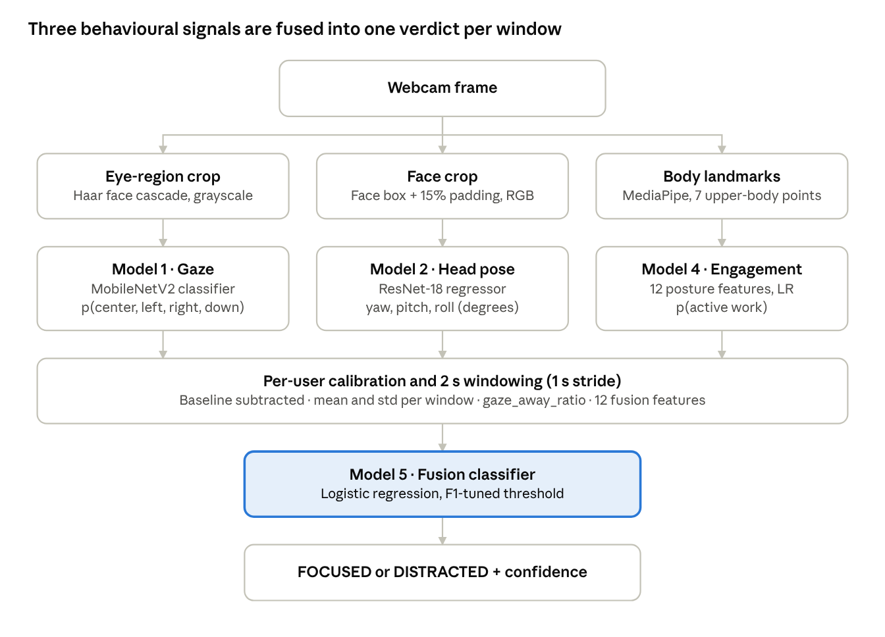
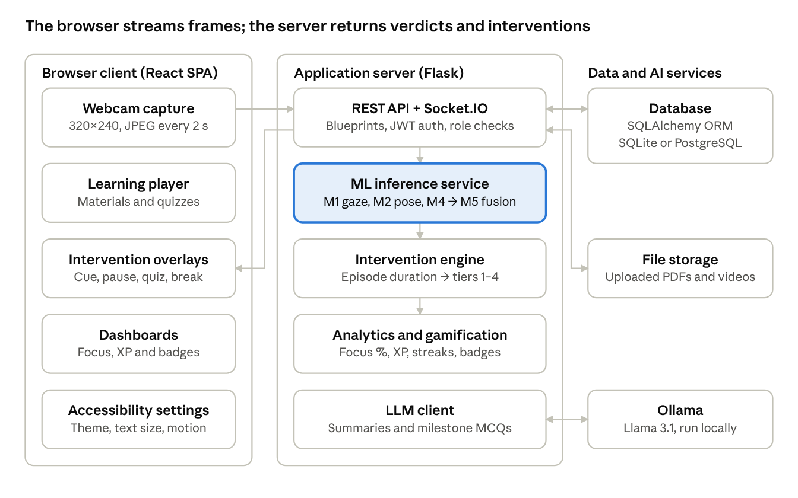

# Thesis — Methodology Chapter

## 3.1 Introduction

This study uses a design-science approach. Its research artefact is a multimodal, webcam-based distraction detection model. That model is built into an ADHD-friendly Learning Management System (LMS), which uses its output to deliver adaptive interventions while a student is learning.

The chapter has two parts. The first covers the research component: how the distraction model was designed, how its data was prepared and how it was trained. The second covers the full system that delivers the model to students, teachers and administrators, along with the technologies used to build it.

### 3.1.1 Research objectives

1. Detect, in real time, when a learner's visual attention leaves the learning content, using only a standard laptop webcam.
2. Combine several separate behavioural cues (eye gaze, head orientation and upper-body activity) into one robust focus/distraction decision, rather than relying on a single cue.
3. Run detection inside a web-based LMS without special hardware, and keep the student's consent and privacy at the centre of the design.
4. Turn detected distraction into timely, low-disruption interventions designed for learners with ADHD.

### 3.1.2 Overall approach

The problem is broken into specialised sub-models, each trained for one behavioural signal on the data source best suited to it. A late-fusion classifier then combines their outputs over short time windows. This modular design has three advantages:

- Each sub-model can be trained on a large public benchmark dataset, even though no large labelled dataset of distracted learners exists.
- Each signal stays interpretable: the system can explain a decision, for example by reporting that the head is turned away or that the eyes are looking down.
- Any one component can be improved or replaced without retraining the whole pipeline.

## 3.2 Research Component: Multimodal Distraction Detection Model

The research component is a hierarchical, late-fusion model. Three perception sub-models each take webcam frames and turn them into a behavioural signal: eye-gaze direction, head orientation and upper-body engagement. A fusion classifier then combines these signals over a short time window to decide whether the learner is *focused* or *distracted*.

*Figure 3.1: Multimodal distraction detection pipeline.* Each sub-model reads its own region of the frame. Per-user calibration and 2-second windowing then turn their outputs into the 12 features the fusion classifier scores.

### 3.2.1 Problem formulation

Distraction detection is framed as binary classification over time windows. The webcam stream is cut into overlapping windows of 2 seconds, with a new window starting every 1 second. Each window *w* gets a label y ∈ {0 = focused, 1 = distracted}. Classifying windows instead of single frames smooths out momentary noise, such as a blink or a brief glance, and captures behaviour that lasts over time, which is what defines inattention.

### 3.2.2 Data sources

No public dataset labels distraction for learners in front of a webcam. Each sub-model was therefore trained on the benchmark dataset best suited to its signal, and the fusion stage was trained on webcam sessions recorded for this study.

| Data source | Used for | Content | Label type |
| --- | --- | --- | --- |
| MPIIGaze (normalised subset) | Model 1: gaze direction | Normalised grayscale eye patches from 15 participants (p00–p14), recorded in everyday laptop use over several days | 3-D gaze vector per eye |
| BIWI Kinect Head Pose | Model 2: head pose | RGB face frames from 20 subjects with ground-truth head rotation | 3×3 rotation matrix per frame |
| Self-recorded webcam sessions | Model 4: engagement; Model 5: fusion | Laptop-webcam recordings of a participant in three scripted conditions: *focused*, *natural* study and deliberately *distracted* | Session-level condition (weak label) |

For the public datasets, every split is **subject-wise**: no person appears in more than one of the training, validation and test sets. This makes evaluation reflect how the model generalises to people it has never seen.

### 3.2.3 Model 1: Gaze direction classifier

**Data preparation.** For each normalised eye image, the gaze vector g = (gx, gy, gz) is converted into yaw and pitch angles:

$$
\text{yaw} = \operatorname{atan2}(g_x, -g_z), \qquad \text{pitch} = \operatorname{atan2}\!\left(g_y, \sqrt{g_x^2 + g_z^2}\right)
$$

These continuous angles are turned into discrete gaze directions. A sample is *center* when both |yaw| and |pitch| are below 10°. Otherwise the axis with the larger angle decides the class: *left* or *right* for yaw, *up* or *down* for pitch. Left and right eye images are treated as separate samples. The *up* class was dropped because looking upward is rare and not meaningful in a learning setting. That leaves a 4-class problem: **center, left, right, down**. Participants p00–p10 form the training set, p11–p12 the validation set and p13–p14 the test set.

**Architecture.** The model uses transfer learning on **MobileNetV2** pre-trained on ImageNet, with its final classifier replaced by a 4-way linear layer. MobileNetV2 was chosen because its depthwise-separable convolutions make it light enough to run on a CPU for live, per-frame inference. The single grayscale channel is copied into three channels so the ImageNet-pretrained weights can be reused.

**Training.** Inputs are resized to 224×224 and normalised with ImageNet statistics. Training-time augmentation adds random rotation (±5°) and brightness/contrast jitter (±20%) to simulate different webcam conditions. Because the classes are imbalanced, the loss is class-weighted cross-entropy, with weights set to the inverse of each class's frequency. Optimisation used AdamW (learning rate 3×10⁻⁴, weight decay 10⁻⁴) with cosine-annealing learning-rate decay, for 15 epochs at batch size 128, using automatic mixed precision (AMP) on a CUDA GPU. After every epoch the model was scored on the validation set, and the checkpoint with the best **macro-F1** was kept.

### 3.2.4 Model 2: Head pose regressor

**Data preparation.** Each BIWI pose file holds a rotation matrix *R*. It is converted to Euler angles in degrees using the ZYX convention: yaw about Z, pitch about Y and roll about X. A fallback handles gimbal lock. Frames are resized to 224×224 RGB. Subjects 01–14 form the training set, 15–17 the validation set and 18–20 the test set.

**Architecture and training.** An ImageNet-pretrained **ResNet-18** backbone has its final fully connected layer replaced by a 3-unit regression head that outputs (yaw, pitch, roll). Head pose is treated as continuous regression, not classification, so the fusion stage gets fine-grained angles. The loss is Smooth L1 (Huber), which is less sensitive than mean squared error to outlier frames with noisy labels. Optimisation used AdamW (learning rate 3×10⁻⁴, weight decay 10⁻⁴) for 10 epochs at batch size 64, with optional mixed precision. The model is evaluated by the mean absolute error (MAE) of each angle.

### 3.2.5 Model 4: Upper-body engagement classifier

Gaze and head pose show where a learner is looking. They do not show whether the learner is *actively working*, for example writing or using the keyboard. Model 4 adds that behavioural context from body posture.

**Landmark extraction.** The **MediaPipe Pose Landmarker** (lite model, video mode, detection confidence ≥ 0.5) is run on every frame. From its 33 landmarks, seven upper-body keypoints are kept: the nose, both shoulders, both elbows and both wrists. Each keypoint has normalised (x, y) coordinates and a visibility score.

**Feature engineering.** Landmarks are grouped into 2-second windows with a 1-second stride. Each window is summarised by 12 hand-crafted features:

- *Pose presence*: the share of frames in which a body was detected (pose_ratio).
- *Hand motion*: the mean and standard deviation of each wrist's speed between frames.
- *Hand position*: the mean distance from each wrist to the nose, and to the midpoint between the shoulders.
- *Head stability*: nose jitter, measured as the standard deviation of the nose position.
- *Desk-zone posture*: the share of frames in which each wrist is below shoulder level, which indicates writing or typing.

**Weak supervision.** No manual frame labels were available, so labels were generated by rules (weak supervision). A window is labelled *active work* when all four of these conditions hold:

- a pose is visible in more than 70% of frames;
- at least one wrist is below the shoulders in more than 60% of frames;
- mean wrist speed is above 0.002 in normalised units, meaning the hands are moving a little;
- nose jitter is below 0.01, meaning the head is stable.

**Classifier.** A **logistic regression** model with z-score feature standardisation and balanced class weights learns from these weak labels. The data is split 75/25 into training and test sets, stratified by class. Learning a model from rule-based labels, rather than applying the rules directly, gives a smooth engagement *probability* that the fusion stage can use, and it generalises past the hard thresholds of the rules.

### 3.2.6 Real-time feature extraction and per-user calibration

The same preprocessing is used both when building the fusion dataset and when running live, so the features the model sees in use match those it was trained on.

1. **Region of interest.** An OpenCV Haar-cascade detector finds the largest face in the frame. For gaze, a band covering roughly 18–55% of the face height and 10–90% of its width is cropped as the eye region and converted to grayscale. For head pose, the face box is enlarged by 15% padding; if no face is found, the central 60% of the frame is used instead.
2. **Per-frame inference.** Model 1 produces four gaze-class logits, Model 2 produces yaw, pitch and roll, and MediaPipe produces the body landmarks.
3. **Baseline calibration.** The first second of each recording is used as a personal neutral baseline. The mean gaze logits and mean head angles over that second are subtracted from all later frames. This removes differences caused by camera placement and the user's posture. After calibration, the *center* logit gets a small fixed boost, so that the user's neutral, screen-facing pose counts as attentive.
4. **Windowing.** Softmax gaze probabilities and calibrated head angles are averaged over each 2-second window with a 1-second stride. The engagement model scores the same windows.
5. **Alignment.** Each model's windows are matched on (video_id, window_start_sec), with start times rounded to the nearest second, and joined with an inner join to produce one multimodal feature vector per window.

### 3.2.7 Model 5: Late-fusion classifier

**Fusion features.** Each window is described by 12 features taken from the three perception models:

| Group | Features | Source |
| --- | --- | --- |
| Gaze distribution | p_center_mean, p_left_mean, p_right_mean, p_down_mean | Model 1 |
| Gaze aversion | gaze_away_ratio | Derived from Model 1 |
| Head orientation | yaw_mean, pitch_mean, roll_mean | Model 2 |
| Head movement | yaw_std, pitch_std, roll_std | Model 2 |
| Engagement | engagement_prob_mean | Model 4 |

The gaze-aversion ratio is the share of gaze probability that falls outside the screen-centre class:

$$
\text{gaze\_away\_ratio} = \frac{p_{left} + p_{right} + p_{down}}{p_{center} + p_{left} + p_{right} + p_{down}}
$$

**Hybrid weak labelling.** Fusion labels combine the condition each session was recorded under with a sanity check on the features:

- A window from a *distracted* session is labelled distracted (y = 1) only if it actually shows aversion: gaze_away_ratio above 0.20, or |yaw| or |pitch| above 10°.
- A window from a *focused* or *natural* session is labelled focused (y = 0) only if |yaw| and |pitch| are both below 40°.
- Any window that contradicts its session's condition is marked ambiguous and left out.

This cuts the label noise that comes from naïve session-level labelling. Even a deliberately distracted participant has attentive moments, and a focused participant occasionally looks away.

**Split and classifier.** The labelled windows are split into training, validation and test sets (70/15/15), stratified by class so that each set contains both classes. The classifier is a **standardised logistic regression** (lbfgs solver, up to 2,000 iterations, C = 1.0). It was chosen deliberately over a deeper model for three reasons:

1. The fusion dataset is small, and a low-capacity linear model is less likely to overfit it.
2. Each feature's coefficient can be read directly as its contribution to the distraction decision, which keeps the model interpretable.
3. It runs in microseconds, so it adds no measurable delay to live monitoring.

**Decision-threshold tuning.** The default probability threshold of 0.5 is not assumed to be best. The threshold is searched over 181 evenly spaced values between 0.05 and 0.95, and the one that gives the highest **F1-score** on the validation set is chosen. The model, its feature order and the tuned threshold are stored together as one serialised package, so live inference uses exactly the same configuration as training.

### 3.2.8 Inference output

At run time the fusion model outputs a distraction probability p for the current window. The window is labelled DISTRACTED when p is at or above the tuned threshold, and FOCUSED otherwise. The reported confidence is p for a distracted verdict and 1 − p for a focused one. If no face is detected in the frame, the system immediately returns a distracted verdict, since a learner who is absent from the camera cannot be attending to the content.

## 3.3 System Design: ADHD-Friendly Adaptive LMS

The distraction model is delivered through a full-stack web LMS with a three-tier client–server architecture. The browser client captures webcam frames and presents the learning content. The application server runs the trained models in-process, tracks distraction episodes and decides on interventions. The database stores learning content, sessions and analytics.

*Figure 3.2: System architecture.* Every 2 seconds the client posts a frame to the heartbeat API. The ML service scores it and the intervention engine chooses a tier. The reply carries the verdict, and any intervention, back to the overlay.

### 3.3.1 Architecture overview

- **Presentation tier.** A React single-page application with separate, role-based workspaces for students, teachers and administrators. It talks to the server through a REST API (Axios) and a Socket.IO channel.
- **Application tier.** A Flask application built with the app-factory pattern, with route blueprints for auth, courses, quizzes, sessions, analytics, student profile and admin. Its service layer contains the **ML inference service**, the **intervention engine**, the gamification, analytics and focus-metric services, an LLM client, a CSV user importer and file storage.
- **Data tier.** A relational database accessed through the SQLAlchemy ORM: SQLite during development and testing, PostgreSQL in deployment. Uploaded learning materials (PDFs and videos) are kept in server-side file storage.
- **External AI service.** A locally hosted large language model, served by Ollama, which generates summaries of learning material and checkpoint questions.

The ML service is loaded **in-process** as a singleton when the server starts. The models are loaded into memory once and reused for every request, so each frame avoids the cost of a network call to a separate model server.

### 3.3.2 User roles and functional modules

| Role | Main functions |
| --- | --- |
| Student | Browse enrolled subjects and modules; study video and document materials in a monitored session; attempt quizzes; respond to interventions; view personal focus analytics, XP, streaks and badges; set accessibility preferences |
| Teacher | Create subjects, modules and materials; upload files; build quizzes; generate and edit AI-assisted summaries and milestone questions; turn intervention tiers on or off per subject; view class and per-student focus analytics |
| Administrator | Manage users (individually or by CSV bulk import), grade levels and enrolments; record guardian consent; configure system-wide settings such as the intervention cooldown; view platform analytics and logs |

Access control is role-based and enforced on the server. Every protected endpoint needs a valid JWT access token and passes through a role-checking decorator.

### 3.3.3 Live monitoring pipeline

One monitored learning session runs as a closed loop:

1. **Consent check.** When the student starts a session, the server confirms that guardian consent is on record. Without it, monitoring cannot start.
2. **Capture.** The browser opens the front-facing webcam through the MediaDevices API (getUserMedia) at 320×240 and 15 fps. Every 2 seconds it draws the current frame onto a hidden canvas and encodes it as a compressed JPEG in base64. Only one request is in flight at a time.
3. **Heartbeat.** The frame is sent to `POST /api/session/{id}/heartbeat`, along with whether the student is currently in a quiz.
4. **Inference.** The ML service decodes the frame and runs Models 1, 2 and the pose landmarker on it. The results go into a ring buffer kept for each session. The most recent frames (3 by default, configurable) form the current window, which Models 4 and 5 score to produce a verdict and confidence (Section 3.2).
5. **Episode tracking.** A DISTRACTED verdict opens a *distraction episode*, or extends one already open. The next FOCUSED verdict closes it and records the end time. Distraction is therefore measured as continuous episodes with a duration, not as isolated frame labels.
6. **Intervention decision.** The intervention engine reads how long the open episode has lasted and decides whether to fire an intervention (Section 3.3.4).
7. **Response.** The heartbeat reply returns the verdict, confidence, ML mode and any intervention payload. The client shows the intervention as an overlay.
8. **Outcome logging.** The student's reaction to the intervention (re-engaged, ignored or ended session) is sent back to the server, along with the time it took them to re-engage. This feeds the next decision and the analytics.

**Graceful degradation.** The ML service reports a mode with every verdict. The mode is *full* when all four checkpoints are loaded, *partial* when some are loaded, and *fallback* when none are, in which case OpenCV Haar-cascade face and eye heuristics with fixed thresholds are used instead. The platform keeps working, at reduced quality, if a model file is missing.

### 3.3.4 Adaptive micro-intervention engine

Interventions follow a tiered, escalating design. The aim is to bring an ADHD learner's attention back with the least disruptive prompt that works, interrupting more only when gentler prompts fail.

| Open episode duration | Tier | Intervention |
| --- | --- | --- |
| under 5 s | 0 | None: brief glances are tolerated |
| 5–10 s | 1 | Ambient cue: a gentle visual prompt to refocus |
| 10–20 s | 2 | Pacing pause: content pauses until the student taps to continue |
| 20–40 s | 3 | Milestone quiz on the material (during a quiz: a hint instead) |
| 40 s or more | 4 | Content pacing reduction (playback at 0.75×); after that, a suggested break |

The engine applies these control rules:

- **Escalation:** if the previous intervention was ignored, the next one is at least one tier higher.
- **Cooldown:** interventions are at least 30 seconds apart. Administrators can change this value.
- **No stacking:** a new intervention cannot fire while the student has not yet responded to the current one.
- **De-escalation:** as soon as the verdict returns to FOCUSED, escalation resets.
- **Teacher control:** teachers can turn each tier on or off per subject. If the computed tier is disabled, the engine falls back to the nearest enabled lower tier.

Every intervention is logged with its tier, its type, the episode that triggered it, the student's response and how long the student took to re-engage.

### 3.3.5 LLM-assisted content generation

Milestone-quiz interventions need questions about the specific material. To avoid making teachers write them all by hand, the teacher's description of a material is sent to a locally hosted LLM (Llama 3.1 via the Ollama API) with a structured prompt. The LLM returns JSON containing a 2–4 sentence student-facing summary and multiple-choice checkpoint questions, each with four options, the index of the correct option and a hint. The teacher reviews and edits the output before it is saved. During a session, a Tier 3 intervention picks the next active milestone question for the current material. Running the LLM locally means no course content leaves the institution's infrastructure.

### 3.3.6 Focus analytics and gamification

A session's focus percentage is the share of its total time not covered by distraction episodes:

$$
\text{Focus\%} = \frac{T_{session} - \sum_i T_{episode,i}}{T_{session}} \times 100
$$

Daily summaries record sustained-inattention counts, distraction frequency per minute and average engagement. These figures drive dashboards for students, teachers and administrators, built from charts of focus trends, interventions and re-engagement.

To reinforce attention positively, students earn experience points (XP):

- 2 XP per focused minute;
- 10 XP per correct answer, plus a 25 XP bonus for a perfect quiz;
- 40 XP per completed module.

XP builds up into levels. The platform also tracks daily-activity streaks and a daily focus goal (20 minutes by default), and awards milestone badges. These features follow the ADHD-intervention literature, which finds that immediate, frequent rewards motivate better than delayed ones.

### 3.3.7 ADHD-friendly interface design

The interface was designed to reduce cognitive load and sensory overload:

- a low-clutter layout with consistent navigation;
- a calm-dark theme option;
- adjustable text size;
- a reduce-motion mode;
- optional sound effects;
- an optional live camera preview;
- configurable break reminders (every 18 minutes by default).

A *Focus Buddy* companion and a visible monitoring indicator always show the student when the camera is active. First-time onboarding explains the monitoring before it starts.

### 3.3.8 Data model

The main entities are:

- **Accounts:** User (with a role) and its Student and Teacher profiles; GuardianConsent.
- **Curriculum:** GradeLevel, Subject, TeacherSubject, Enrollment, Module, ModuleContent and ModuleMilestoneItem; Quiz and its questions.
- **Monitoring:** LearningSession, DistractionEvent (an episode with start and end times) and InterventionLog.
- **Interventions:** MilestoneQuestion and InterventionConfig (which tiers are on, per subject).
- **Analytics:** DSMSummary (the daily summary).
- **Gamification:** StudentProgress, Badge and StudentBadge.
- **Configuration:** SystemSetting.

Because distraction is stored as timed episodes linked to interventions and responses, the analysis can go beyond counting distractions to examine whether the interventions worked.

## 3.4 Technologies and Tools

The technologies were chosen to meet three requirements: real-time inference on an ordinary computer without a GPU, the reuse of mature pre-trained vision models, and an accessible interface that responds immediately. The whole stack is open source.

### 3.4.1 Machine learning and computer vision

| Technology | Role in the project | Reason for selection |
| --- | --- | --- |
| Python | Language for all model research, data preparation and the backend | The standard ecosystem for ML research and deployment |
| PyTorch and torchvision | Training and running the gaze (MobileNetV2) and head-pose (ResNet-18) CNNs; ImageNet-pretrained weights; data loaders and augmentation | Flexible deep-learning framework with pretrained backbones, GPU mixed-precision training and CPU inference |
| scikit-learn | Engagement and fusion logistic-regression pipelines (StandardScaler, LogisticRegression); data splits; evaluation metrics | Lightweight, interpretable classical models suited to small tabular datasets |
| MediaPipe Pose Landmarker | Extracting upper-body keypoints for the engagement model | Accurate pose estimation that runs in real time on a CPU and offers a video-tracking mode |
| OpenCV | Reading video, decoding frames, colour conversion and Haar-cascade face and eye detection | Fast, well-established image-processing library |
| NumPy, pandas, SciPy | Numerical feature engineering, window aggregation and reading MPIIGaze .mat files | Standard tools for scientific computing and tabular data |
| Pillow | Image I/O and conversion before applying the model transforms | Integrates directly with torchvision transforms |
| joblib | Saving and loading the scikit-learn model packages, together with their feature lists and thresholds | The standard way to persist scikit-learn models |
| Matplotlib | Plots of dataset distributions, scatter plots and confusion matrices for analysis | Publication-quality figures |
| CUDA (NVIDIA RTX 4050 laptop GPU) | Accelerating CNN training with automatic mixed precision | Shortens training time on a consumer GPU |

### 3.4.2 Backend

| Technology | Role |
| --- | --- |
| Flask 3 | Web framework: REST API, app factory and blueprints |
| Flask-SocketIO with eventlet | Bidirectional real-time telemetry channel |
| Flask-SQLAlchemy and Flask-Migrate | ORM and database schema migrations |
| SQLite / PostgreSQL | Relational storage (SQLite for development and testing, PostgreSQL for deployment) |
| Flask-JWT-Extended | Stateless token authentication, with 8-hour token expiry |
| bcrypt | Password hashing |
| Pydantic and Marshmallow | Validating request payloads and serialising responses |
| Flask-CORS and python-dotenv | Cross-origin policy, and configuration through environment variables |
| Ollama (Llama 3.1) | Locally hosted LLM for generating material summaries and milestone questions |
| pytest | Automated tests of the API, role-based access control, the intervention engine, gamification and the CSV importer |

### 3.4.3 Frontend

| Technology | Role |
| --- | --- |
| React 19 | Component-based single-page user interface |
| Vite | Development server and production bundler |
| React Router 7 | Client-side routing with protected, role-based routes |
| Tailwind CSS 4 | Utility-first styling, including the theming and text-size preferences |
| Axios and Socket.IO client | REST calls with JWT interceptors, and real-time communication |
| Recharts | Focus and intervention analytics charts |
| Lucide icons and canvas-confetti | Consistent iconography, and reward feedback for gamification |
| MediaDevices (getUserMedia) and Canvas APIs | Webcam access and JPEG frame capture in the browser |

### 3.4.4 Development tools

The project used Git for version control, Visual Studio Code as the development environment, ESLint for frontend code quality and Python virtual environments to isolate dependencies. Standalone scripts (a desktop webcam tester and per-model video testers) let each model be validated on its own, outside the web application.

## 3.5 Evaluation Strategy

Each part of the system is evaluated against metrics suited to its task. The results are reported in the evaluation chapter.

| Component | Evaluation method | Metrics |
| --- | --- | --- |
| Model 1: Gaze | Held-out test participants (subject-wise split) | Accuracy, macro-F1, per-class precision and recall, confusion matrix |
| Model 2: Head pose | Held-out test subjects | Mean absolute error (°) for yaw, pitch and roll |
| Model 4: Engagement | Stratified 25% hold-out | Accuracy, precision, recall, F1, confusion matrix |
| Model 5: Fusion | Stratified validation set (threshold tuning) and test set | Precision, recall, F1, ROC-AUC, PR-AUC, confusion matrix |
| End-to-end pipeline | Recorded focused, natural and distracted sessions replayed through the full pipeline, with annotated output videos | Qualitative agreement of the per-window verdicts with the recorded condition |
| Application | Automated pytest suite and functional testing of each role's workflows | Pass or fail against the functional requirements |

Macro-averaged F1 is the main metric for the classifiers because it weights every class equally, whatever the class imbalance. A model that always predicts the majority class cannot score well on it.

## 3.6 Ethical and Privacy Considerations

The target users are students with ADHD, who may be minors, and the system uses camera monitoring. Privacy-by-design principles were therefore applied:

- **Informed consent:** monitored sessions cannot start without guardian consent recorded by an administrator. The student also gives a separate, soft assent during onboarding.
- **Data minimisation:** frames are captured at low resolution (320×240) at a low rate (one every 2 seconds). They are processed in memory and then discarded. Only derived results are stored: verdicts, confidence and episode timings.
- **Transparency:** an on-screen monitoring indicator is shown whenever the camera is active. Students can choose to see their own camera preview, and every intervention is explained in plain language.
- **Supportive, not punitive:** detections lead only to supportive prompts and rewards. They never lead to grading penalties.
- **Local AI processing:** inference, and LLM content generation, run on infrastructure the institution controls. No video or course material is sent to third-party cloud services.
- **Security:** passwords are hashed with bcrypt, tokens expire, every endpoint enforces role-based access control, and cross-origin requests are restricted to known origins.

## 3.7 Summary

This chapter described a two-level methodology. At the research level, a hierarchical multimodal model fuses three behavioural cues over 2-second windows into a single focused/distracted decision:

- eye-gaze direction, from a MobileNetV2 classifier trained on MPIIGaze;
- head orientation, from a ResNet-18 regressor trained on BIWI;
- upper-body engagement, from MediaPipe landmarks and a weakly supervised logistic-regression model.

The fusion classifier is a weakly supervised logistic regression with a tuned decision threshold, and per-user calibration is applied before features reach it. At the system level, the model is embedded in a React and Flask LMS. That LMS turns timed distraction episodes into escalating micro-interventions, generates checkpoint content with a local LLM, and supports learners with ADHD-friendly design and gamification.
