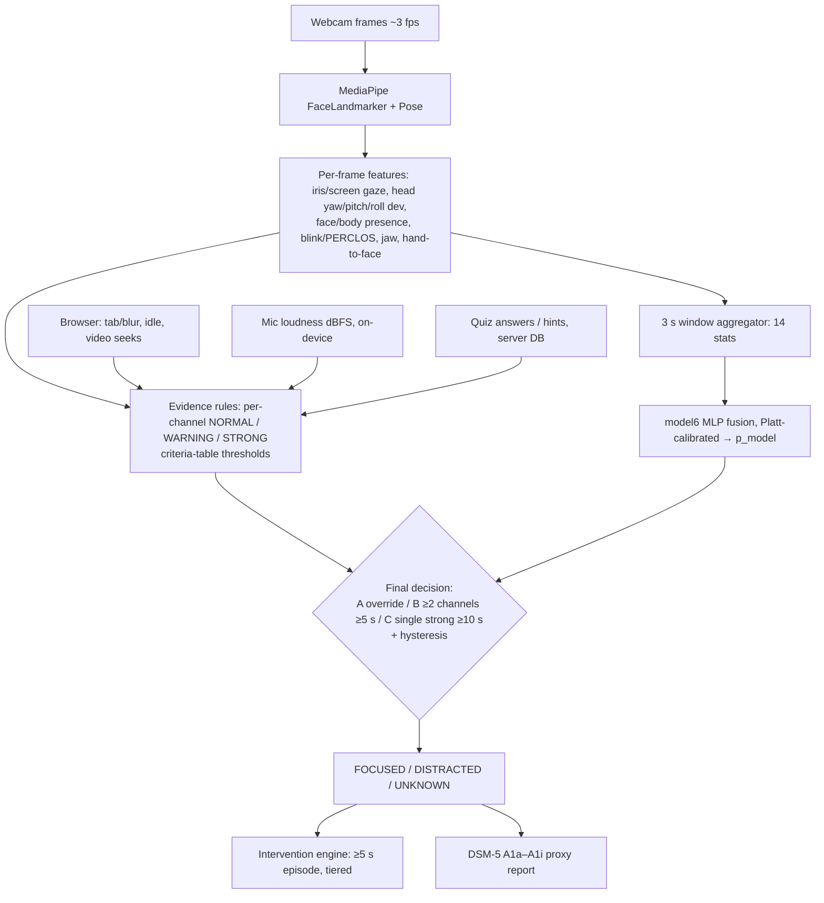

# PLAN 6 — Evidence-rule layer (criteria table) + DSM-5 mapping on top of model6

Status: proposed (2026-11-15). Builds on the uncommitted PLAN 5 work (screen gaze, demo interventions).

> Note (PLAN 8): the evidence tracker stays **unwired** — its 5 s two-signal rule contradicts PLAN 8's 3 s T1.

## Decisions taken

- **Runtime stays model6** (MediaPipe face/pose features → 14-feature window → model6 MLP, Platt-calibrated).
  The architecture diagram is redrawn to match (§7). M1 MobileNetV2 / M2 ResNet-18 checkpoints are not
  deployed (`models/outputs/checkpoints/` holds only `model6_natural`, `model6_v3`), so the old diagram
  described the legacy model5 path, not what runs.
- **Audio = existing on-device loudness (dBFS) only.** Only a noisy environment is detected. Speech and
  media rows of the table are documented as out of scope.
- **Goal:** the obvious distractions are caught reliably, using the thresholds from the criteria table,
  and short, normal behaviour (glances of 1–3 s, posture shifts, a single noise) is never flagged.

## 1. Gap analysis: table vs current code

| Table row | Table rule | Current behaviour | Gap |
|---|---|---|---|
| Gaze | 1–3 s away = normal; 3–5 s repeated = warning; >5 s repeated = strong | `ML_GAZE_OFFSCREEN_SEC=2.0` → p=0.9 **and bypasses the enter hold** (`ml_service._gaze_probability`, `force_enter`) | Flags at 2 s, inside the "normal" band. |
| Head pose | Quick turns normal; >3–4 s repeated + other signals = strong | model6 hysteresis enter 3 s @ p≥0.6 | No "repeated" counting, no corroboration. |
| Face presence | <2 s normal; 2–3 s occasional = warning; >2–3 s repeated = strong | No body+face → 10 s grace then p=0.85; face<60 % with body → p=0.7; else UNKNOWN | Leaving the seat takes 10 s+; no repetition logic. |
| Noise spikes | One-off normal; repeated = warning; repeated + gaze away/idle = strong | `NoiseMonitor`: +12 dB for 4 beats → one notice **per session**, never combined | No spike counting, not used as evidence. |
| Speech / media | — | — | **Out of scope** (decision above). |
| Idle | Short idle normal; 8–10 s warning; >10 s + gaze/head away strong | Only `/behaviour/idle` ≥15 s on quiz/document, record-only | Not in live decision; threshold 15 s not 8–10 s. |
| Fast scroll / skipping | Fast skip + minimal engagement = warning; + gaze away = strong | Not captured | Missing. |
| Task abandonment | Starts task, doesn't finish + extended idle | DSM-3 = quiz overtime only | Partial. |
| Error streak | Errors + gaze away/idle/no correction | DSM-4 = ≥3 wrong **easy** in a row, record-only | Not combined with live signals. |
| Hints repeated | Repeated hints **without improvement** + gaze/idle | DSM-5 = hint on *every* question | Different definition. |
| Temporal rule | Patterns persist 5–10 s across 2+ signals | Single-signal hysteresis | Missing. |
| Final fusion | Flag when ≥2 signals persist; intervene only if probability stays high | One signal (gaze dwell, tab) is enough | **Main gap.** Intervention side already OK: `distraction_level_from_duration` <5 s → no intervention. |

## 2. New module: `backend/app/services/distraction_evidence.py`

A per-session `EvidenceTracker` (pure Python, no Flask and no DB access, so it's easy to unit-test). Every
threshold is a named constant whose comment cites its table row.

```
Level = NORMAL | WARNING | STRONG
Channel = gaze | head | face | noise | idle | skipping | quiz_errors | hints | tab
```

Each channel keeps the current run length and a deque of past episodes (start, end) over a rolling
`REPEAT_WINDOW_SEC = 60`. "Repeatedly" means ≥2 episodes in that window.

| Channel | Input (already on server unless noted) | WARNING | STRONG |
|---|---|---|---|
| gaze | `LiveWindowScorer.gaze_summary()` off_dwell_sec | run ≥3 s, or ≥2 runs of 3–5 s in 60 s | run >5 s **and** repeated, or run ≥10 s continuous |
| head | window `head_yaw_dev` / `head_pitch_dev` outside the on-screen cone (`windows._on_screen`) | run ≥3 s | run >4 s and repeated |
| face | `face_present_ratio`, `body_present_ratio` | face missing 2–3 s | missing >3 s repeated, or no face+no body ≥5 s |
| noise | heartbeat `noise_dbfs` vs `NoiseMonitor.baseline_dbfs` (+12 dB = spike) | ≥3 spikes in 60 s | repeated spikes **while** gaze/idle ≥ WARNING |
| idle | **new** heartbeat field `idle_ms` (from existing `useIdleTracker`) — ignored while lesson video is playing | 8–10 s | >10 s **and** gaze/head ≥ WARNING |
| skipping | **new** heartbeat fields `seek_forward_count`, `seek_forward_sec` (video) | ≥2 forward seeks (>15 s each) in 60 s | + gaze/head ≥ WARNING |
| quiz_errors | server-side from `QuizAnswer` rows of the active attempt (not client-reported) | ≥3 wrong in a row | + gaze/idle ≥ WARNING |
| hints | server-side: same question's hint opened ≥2× with no correct answer after | ≥2 repeats | + gaze/idle ≥ WARNING |
| tab | existing `hidden_ms` / `blurred_ms` | — | hidden ≥3 s / blur ≥5 s (unchanged) |

### Final decision (table "Temporal rule" + "Final decision")

```
DISTRACTED if any of:
  A. unambiguous override: tab STRONG, or face channel "no face + no body ≥5 s" (left seat)
  B. ≥2 distinct channels at ≥WARNING, overlapping continuously for ≥ PERSIST_SEC (5 s),
     and fused probability p ≥ enter_prob
  C. one channel STRONG continuously for ≥ SINGLE_STRONG_SEC (10 s)   # upper end of "5–10 s"
otherwise FOCUSED (or UNKNOWN on the existing low-face / calibrating paths)
```

- `p_fused = max(p_model6, p_rules)`, where `p_rules` = 0.5 at one WARNING, 0.7 at two, 0.9 at STRONG.
  model6 stays the ML arbiter and the rules make the decision explainable and table-compliant.
- model6 hysteresis (enter 0.6/3 s, exit 0.4/2 s) still smooths the output. **Remove** the gaze
  `force_enter` bypass and `_gaze_exit_hold`. The temporal rule replaces them.
- Interventions are unchanged: they already require the episode to last ≥5 s (`distraction_level_from_duration`),
  which matches "intervention triggers only if probability stays high". Keep the existing ≥50 % coverage gate.

### Obvious-distraction scenarios this must catch (acceptance)

| Scenario | Channels | Expected |
|---|---|---|
| Looks down at phone 8 s | gaze + head (pitch) | DISTRACTED by rule B at ~5 s |
| Turns to talk to someone 6 s | head (yaw) + gaze | DISTRACTED (B) |
| Leaves seat | face (no face + no body ≥5 s) | DISTRACTED (A) |
| Switches tab ≥3 s | tab | DISTRACTED (A) |
| Stares away 12 s, no other signal | gaze STRONG | DISTRACTED (C) |
| Noisy room + looking around | noise + gaze | DISTRACTED (B) |
| Brief 2 s glance away | gaze < WARNING | FOCUSED |
| One loud bang | 1 spike | FOCUSED, no notice |
| Watching video without touching mouse 30 s | idle ignored during playback | FOCUSED |
| Looks away 4 s once | single WARNING | FOCUSED (shown as `warning` in the evidence) |

Known limitation (thesis): eyes on screen while mind-wandering is not observable by any channel.

## 3. Wiring changes

- `backend/app/services/ml_service.py`
  - `_decide_live_core`: build the channel inputs from `feats` + `gaze`, call `EvidenceTracker.update()`,
    and apply the final decision. Remove the gaze dwell bypass and the 10 s absent grace; face/absence
    now come from the tracker. Return `evidence: {channel: level}`, `rule: "A"|"B"|"C"|None`, and `p_rules` in `meta`.
  - `GAZE_DWELL_PROB`, `GAZE_PARTIAL_MAX_PROB`, `ML_GAZE_OFFSCREEN_SEC`: retire, or keep only as model input.
- `backend/app/routes/session.py` heartbeat: pass the noise, idle, skipping, tab and quiz inputs into the
  session's tracker (the one tracker owns all channels). Keep the browser-tab override as rule A. Noise
  notice: keep it gentle (tier 1), but fire on noise WARNING instead of "once per session after 4 beats".
- `backend/app/services/noise_monitor.py`: expose `is_spike(level)` plus the spike timestamps. Keep the baseline logic.
- `backend/app/schemas/session_schema.py`: add `idle_ms`, `video_playing`, `seek_forward_count`,
  `seek_forward_sec` (all optional and bounded; they only feed channels and can never set a verdict directly).
- Frontend
  - `frontend/src/hooks/useMonitoringSession.js`: include `idle_ms` (from `useIdleTracker`),
    `video_playing`, and the seek counters in the heartbeat.
  - `frontend/src/components/student/VideoLearningPlayer.jsx`: count forward `seeked` jumps >15 s.
  - `frontend/src/components/student/DemoPanel.jsx`: show the per-channel level chips and the rule that fired.
- `DistractionEvent`: store the channels/rule that opened the episode (JSON column or the existing
  features JSON, so teachers see *why*).

## 4. DSM-5 mapping (fix `dsm_indicators.py`)

The table is the **evidence** layer and DSM-5 the **reporting** layer. The current IDs (DSM-1…7) are not
the DSM-5 numbering. Relabel them to the DSM-5 inattention criteria (A1a–A1i) and feed each from the table rows:

| DSM-5 criterion | Table evidence used | Change |
|---|---|---|
| A1a careless mistakes | error streak (+ gaze/idle) | keep easy-streak ≥3; add "with gaze/idle" as strong |
| A1b difficulty sustaining attention | idle, gaze, head (persisted) | idle threshold 15 s → table 8–10 s warn / >10 s strong |
| A1c does not seem to listen | hints repeated without improvement | replace "hint on every question" with table definition |
| A1d fails to finish | task abandonment, overtime | add started-not-finished + extended idle |
| A1f avoids sustained effort | fast skipping, fast+wrong quiz | add video forward-skip episodes |
| A1h easily distracted by external stimuli | noise (+ gaze), tab switch, head turn | only externally-cued episodes; stop counting *every* camera episode |
| A1i forgetful | missed daily goal | unchanged |
| A1e organising, A1g loses things | — | not observable → listed as "not measured" |

- Each indicator records **counts by level** (warning / strong), not just a raw count.
- Keep the disclaimer and add: "DSM-5 requires ≥6 symptoms persisting ≥6 months across settings; this
  is a learning-behaviour proxy, never a diagnosis."
- Update `backend/tests/test_dsm_indicators.py` and the teacher view labels.

## 5. Tests

- `backend/tests/test_distraction_evidence.py` (new): one test per table cell (normal, warning, strong
  boundaries) plus every acceptance scenario in §2, using synthetic time series.
- Update tests that encode the old 2 s gaze dwell or 10 s absence: `test_s3_fusion_runtime.py`,
  `test_intervention_v4.py`, `models/tests/test_screen_gaze.py`, and the noise tests (spike counting).
- Full suite: `pytest backend/tests models/tests`.
- Manual run with the demo panel: walk through the 10 scenarios on a webcam and record the outcome table
  in `dev/test_outputs/phase6_scenarios.md`.

## 6. Evaluation impact

model6 weights are untouched, so the LOSO window metrics stay valid. The live decision rule changes,
so re-run any session-replay / latency evaluation under `evaluation/` and report the "rule layer" as a
post-model decision policy in Chapter 6. Detection latency for the obvious scenarios is expected at ~5 s,
up from ~2 s for gaze, which is a deliberate trade for fewer false alarms on normal glances.

## 7. Diagram update (replaces the M1/M2/M4/M5 figure)



Export it to `dev/methodology_figures/` and replace the old figure in the thesis.

## Order of work

1. `distraction_evidence.py` + unit tests (no wiring).
2. Wire into `ml_service._decide_live_core`; remove the gaze bypass and the 10 s absent grace; fix existing tests.
3. Heartbeat schema + route: noise spikes, idle, seeks, quiz-side channels.
4. Frontend telemetry + demo panel evidence chips.
5. DSM-5 relabel/mapping + tests.
6. Diagram, manual scenario run, evaluation re-run, thesis text.
